# 6. Diseño Avanzado de PCB en Altium Designer

Altium Designer es una de las herramientas de automatización de diseño electrónico (EDA) más potentes y utilizadas a nivel industrial. En esta sección documentaremos el flujo de trabajo inicial, desde la configuración del entorno y licencias académicas, hasta la creación del proyecto y captura del diagrama esquemático.

---

## 6.1 Instalación y Configuración del Entorno

El primer paso para utilizar Altium Designer es instalar la suite y vincular la licencia correspondiente a nuestra institución.

### Descarga del Instalador
Para obtener el software, nos dirigimos al portal oficial de descargas de Altium. En la sección de Altium Designer, seleccionamos la opción de **Online Installer (exe)**, la cual se encargará de gestionar los paquetes necesarios durante la instalación.

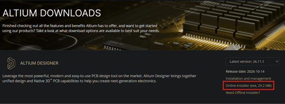{ width="700" }
*Figura 6.1.1: Portal oficial de descargas de Altium.*

### Gestión de Licencias
La primera vez que ejecutemos el programa, se mostrará el panel de administración de licencias (`License Management`). Para habilitar las herramientas de diseño, es necesario iniciar sesión y seleccionar una licencia activa. En este caso, seleccionaremos la licencia profesional institucional (indicada en el recuadro rojo) y haremos clic en el botón para activarla.

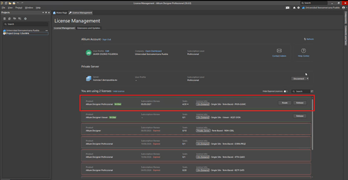{ width="700" }
*Figura 6.1.2: Activación de la licencia institucional en el panel de Altium.*

### Conexión al Workspace Institucional
El último paso crítico antes de diseñar es vincular nuestro entorno con el espacio de trabajo en la nube de la universidad (Altium 365). 

Nos dirigimos a la esquina superior derecha de la interfaz. Si no estamos conectados, hacemos clic en el icono de usuario y seleccionamos **Unirse a un grupo**. Introducimos nuestro correo institucional, la contraseña asignada, y el código de verificación enviado al correo. Al finalizar, el indicador mostrará el estado de conexión activa.

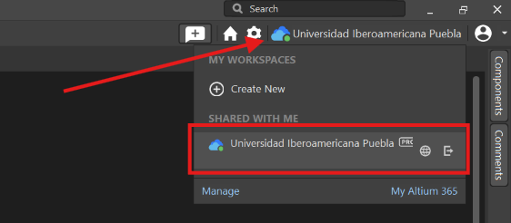{ width="400" }
*Figura 6.1.3: Verificación de conexión activa al Workspace universitario.*

---

## 6.2 Creación y Estructura del Proyecto

Altium Designer organiza los archivos mediante un archivo maestro de proyecto (`.PrjPcb`) que vincula lógicamente los esquemáticos y los diseños físicos de la placa.

### Inicialización del Proyecto
Para crear el directorio contenedor, nos dirigimos a la esquina superior izquierda y seleccionamos la ruta: **`File > New > Project...`**.

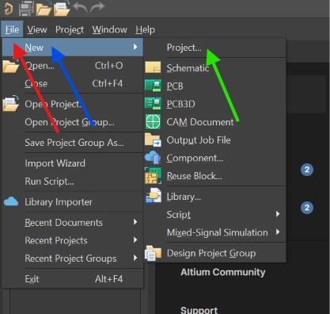{ width="300" }
*Figura 6.2.1: Ruta de acceso para la creación de un nuevo proyecto.*

En la ventana de creación (`Create Project`), por defecto el sistema sugiere guardar el proyecto en la nube institucional. Si deseamos trabajarlo localmente, seleccionamos la opción de **Version Control** o **Local Projects**. Asignamos un nombre estructurado (por ejemplo, `Placa_prueba`) en el campo `Project Name` y hacemos clic en **Create**.

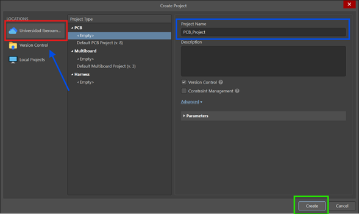{ width="600" }
*Figura 6.2.2: Configuración de nombre y ubicación del proyecto.*

Una vez creado, en el panel lateral **`Projects`** aparecerá el contenedor principal identificado con el ícono verde característico (`.PrjPcb`).

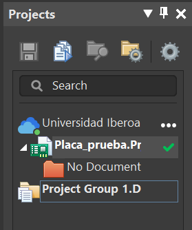{ width="200" }
*Figura 6.2.3: Contenedor del proyecto inicializado en el panel lateral.*

### Creación del Diagrama Esquemático
Para agregar nuestra primera hoja de diseño, hacemos clic derecho sobre el nombre del proyecto en el panel lateral, pasamos el cursor sobre **`Add New to Project`** y seleccionamos **`Schematic`**.

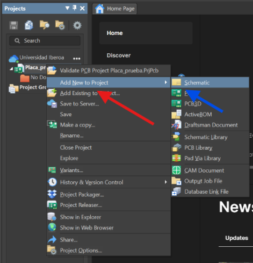{ width="400" }
*Figura 6.2.4: Ruta para añadir un nuevo documento esquemático al proyecto.*

Al realizar esta acción, se generará una hoja en blanco y se abrirá el entorno de captura lógica. Es imperativo **guardar localmente el archivo**. Al notar que el documento tiene un ícono rojo en el panel (indicando que no está guardado), presionamos `Ctrl + S`, asignamos un nombre (`Placa_prueba.SchDoc`) y lo guardamos en nuestro directorio de trabajo.

| Guardado de Archivo | Explorador de Archivos |
| :---: | :---: |
| 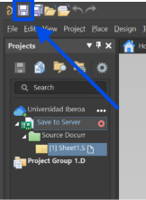{ width="200" } | 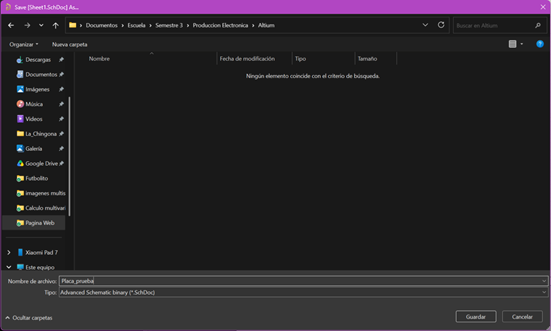{ width="400" } |

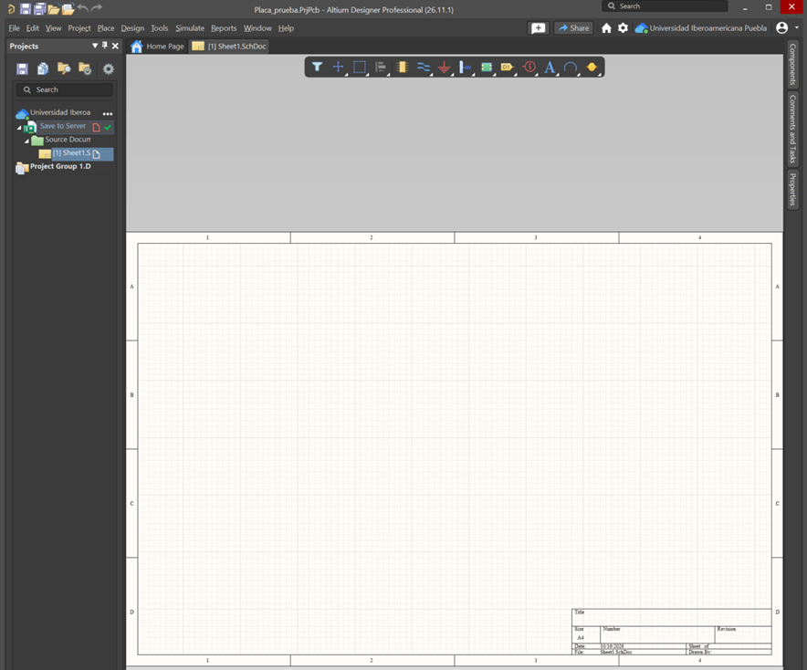{ width="600" }
*Figura 6.2.5: Interfaz del editor de esquemas listo para trabajar.*

---

## 6.3 Exploración de Paneles y Herramientas

Para trabajar de manera fluida, es necesario familiarizarse con la activación y el uso de los paneles de herramientas de Altium Designer.

### Paneles Laterales
En el borde derecho de la interfaz se encuentran pestañas de acceso rápido colapsadas por defecto (`Components`, `Properties`, etc.). El panel **`Components`** es la vía principal para buscar y colocar piezas desde librerías locales. 

Si por error cerramos algún panel lateral, podemos recuperarlo dirigiéndonos a la esquina inferior derecha, haciendo clic en el botón **`Panels`** y seleccionando el panel deseado.

| Panel Components | Recuperación de Paneles |
| :---: | :---: |
| 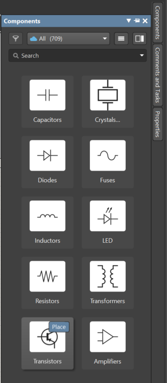{ width="250" } | 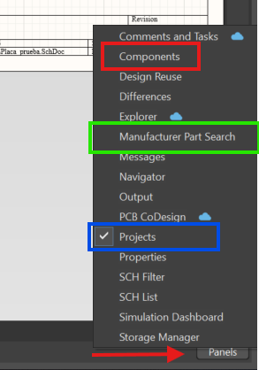{ width="200" } |

### Búsqueda Avanzada: Manufacturer Part Search
A diferencia de las librerías estáticas, Altium ofrece el panel **`Manufacturer Part Search`**. Esta herramienta se conecta en tiempo real con bases de datos globales de proveedores, permitiendo buscar cualquier componente mediante su matrícula o navegando por categorías.

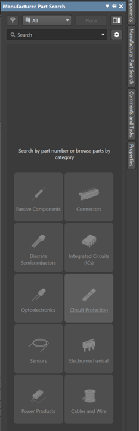{ width="250" }
*Figura 6.3.1: Interfaz de búsqueda global de componentes.*

### Activación de Barras de Herramientas Superiores
Para agilizar el proceso de dibujo, debemos activar las barras de acceso rápido. Al hacer clic derecho sobre el espacio vacío en la barra superior, desplegaremos un menú contextual.

Activamos la casilla **`Wiring`** (Cableado) para mostrar las herramientas de conexión eléctrica (cables, GND, VCC). También activamos **`Schematic Standard`**, **`Formatting`** y **`Utilities`** para habilitar las opciones de dibujo gráfico, zoom y guardado rápido.

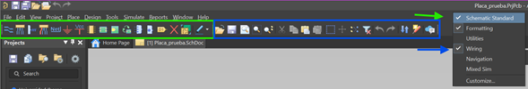{ width="700" }
*Figura 6.3.2: Configuración y habilitación de barras de herramientas superiores.*

---

## 6.4 Organización Visual del Esquemático

Para mantener un diseño profesional y ordenado, estructuraremos el lienzo en bloques funcionales utilizando herramientas de dibujo gráfico.

### Dibujo de Figuras Geométricas
En la barra de utilidades superior, desplegamos el menú del ícono de la regla y el lápiz. Esta herramienta nos permite dibujar formas (`Rectangle`, `Polyline`, `Ellipse`) que servirán como delimitadores visuales para distintas etapas del circuito (ej. entradas, salidas, potencia).

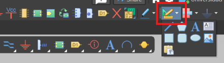{ width="300" }
*Figura 6.4.1: Menú de formas geométricas y anotaciones.*

### Edición de Propiedades Visuales
Al trazar una figura y hacer doble clic sobre ella, se abrirá el panel **`Properties`**. Aquí podemos modificar el grosor de línea (`Line Size`), el color del borde y, activando la casilla `Fill Color`, asignar un color de fondo para resaltar el área.

| Trazo Inicial | Propiedades de Línea | Propiedades de Relleno | Cuadro Terminado |
| :---: | :---: | :---: | :---: |
| 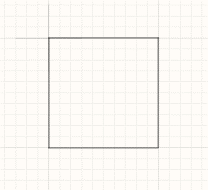{ width="150" } | 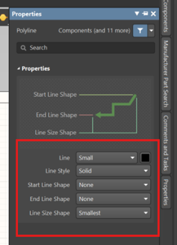{ width="200" } | 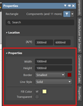{ width="200" } | 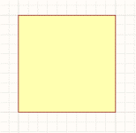{ width="150" } |

### Etiquetado de Bloques
Para identificar cada área, seleccionamos la herramienta de texto (ícono de la letra "A") y la colocamos dentro de nuestro bloque. En el panel `Properties` del texto, ingresamos el nombre de la sección (ej. "Entradas") y ajustamos la fuente, tamaño, color y justificación.

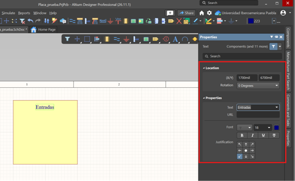{ width="500" }
*Figura 6.4.2: Bloque funcional delimitado e identificado profesionalmente.*

---

## 6.5 Selección y Verificación de Componentes

La correcta elección de componentes es el pilar de un buen diseño. En Altium, debemos garantizar que cada símbolo esquemático posea su representación física correspondiente.

### Búsqueda de Componentes en la Librería
Abrimos el panel **`Components`**. Podemos filtrar la búsqueda desplegando la lista de categorías (ej. `Connectors`, `Diodes`) o ingresando directamente la matrícula del componente en la barra de búsqueda superior.

| Filtrado por Categoría | Búsqueda por Matrícula |
| :---: | :---: |
| 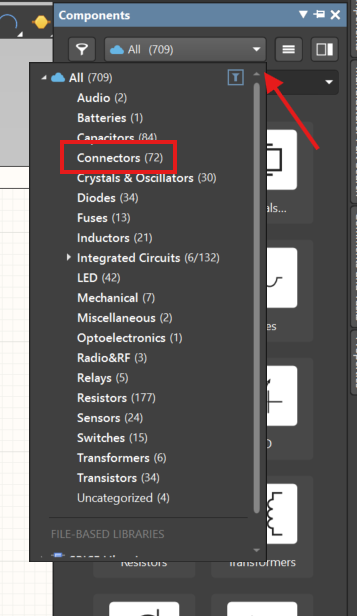{ width="250" } | 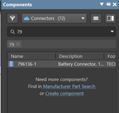{ width="250" } |

### Verificación de Huella (Footprint) y Datasheet
Al seleccionar un componente de la lista, en la sección inferior `Details` se mostrarán sus propiedades técnicas.
1.  **Modelos 3D y Huellas:** Es obligatorio verificar en la sección `Models` que el componente cuente con su símbolo, huella de PCB y diseño 3D. Si carece de huella, no se podrá maquinar.
2.  **Hojas de Datos:** En la sección `References` o `Part Choices`, encontraremos enlaces directos al `Datasheet` en formato PDF. Al hacer clic, Altium abrirá el documento técnico del fabricante para consultar límites de corriente y distribución de pines.

| Verificación de Huella | Enlace a Datasheet | Visualización de PDF |
| :---: | :---: | :---: |
| 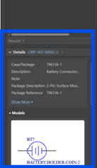{ width="150" } | 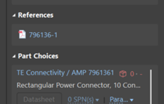{ width="150" } | 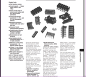{ width="300" } |

### Solución a Componentes sin Huella (SnapMagic)
Si el componente deseado no incluye una huella en las librerías predeterminadas, podemos recurrir a repositorios CAD externos como **SnapMagic Search** (anteriormente SnapEDA) https://www.snapeda.com/. Esta plataforma permite buscar la matrícula exacta y descargar gratuitamente el símbolo, huella y modelo 3D en formato nativo para integrarlo a Altium.

| Modelo 3D Ausente/Básico | Plataforma SnapMagic |
| :---: | :---: |
| 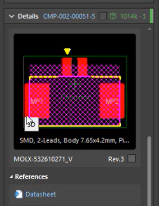{ width="200" } | 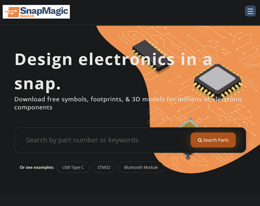{ width="400" } |

---

## 6.6 Emplazamiento y Ruteo Lógico

Con los componentes verificados, procedemos a armar el esquema del circuito eléctrico.

### Acomodo y Rotación
Arrastramos los componentes desde el panel al área de trabajo. Para rotar un componente $90^\circ$, lo seleccionamos con un clic (o mientras lo arrastramos) y presionamos la barra espaciadora.

Ubicamos estratégicamente los elementos en el lienzo. Por ejemplo, situamos el conector dentro del bloque "Entradas" creado anteriormente, y los demás semiconductores a un lado para facilitar el trazado.

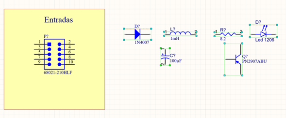{ width="600" }
*Figura 6.6.1: Distribución preliminar de los componentes en el lienzo.*

### Trazado de Conexiones (Wires)
Para interconectar los elementos, activamos el modo de cableado haciendo clic en el ícono **`Place Wire`** (en la barra `Wiring`) o usando el atajo `Ctrl + W`.

Al acercar el cursor a la terminal de un componente, aparecerá una cruz roja indicando un nodo válido. Hacemos clic para iniciar, arrastramos siguiendo trayectorias a $90^\circ$ y hacemos clic en el destino.

| Herramienta Place Wire | Detección de Nodo (Cruz Roja) |
| :---: | :---: |
| 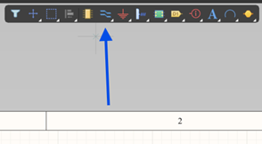{ width="300" } | 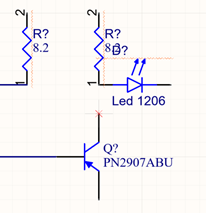{ width="250" } |

### Puertos de Alimentación (Power Ports)
Para conectar las referencias de energía, localizamos el ícono de Tierra en la barra de cableado. Haciendo clic derecho sobre él, desplegamos el menú completo de opciones de voltaje.

Seleccionamos **`Place GND power port`** para el retorno de energía y lo conectamos a la terminal inferior. Luego seleccionamos **`Place +12 power port`** (o el voltaje deseado) y lo conectamos a las terminales de las resistencias.

| Menú de Puertos | Opciones de Alimentación | Circuito Alimentado |
| :---: | :---: | :---: |
| 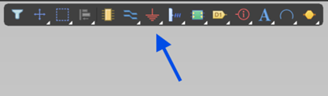{ width="250" } | 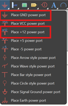{ width="150" } | 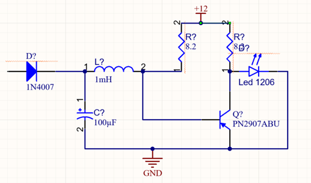{ width="350" } |

---

## 6.7 Etiquetas de Red (Net Labels) y Anotación

Para evitar un exceso de cables cruzando todo el diseño (lo cual disminuye la legibilidad profesional), utilizaremos variables de interconexión inalámbrica.

### Implementación de Net Labels
En la barra de herramientas, hacemos clic derecho sobre el ícono de alambre y seleccionamos **`Net Label`**. Colocamos la etiqueta asegurándonos de que su punto de anclaje toque la línea del cable de destino.

En el panel `Properties`, modificamos el `Net Name` asignando identificadores técnicos (ej. E1, E2, GND, +12). Si repetimos este proceso en las terminales del conector de entradas, Altium creará una unión eléctrica virtual perfecta entre ellos sin necesidad de trazos físicos.

| Selección de Herramienta | Edición de Nombre | Lista de Redes | Conector Etiquetado |
| :---: | :---: | :---: | :---: |
| 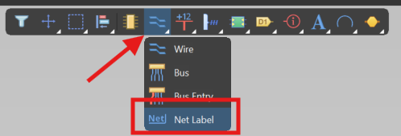{ width="150" } | 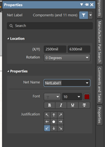{ width="150" } | 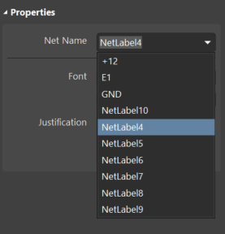{ width="150" } | 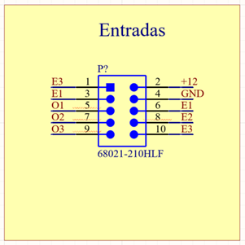{ width="200" } |

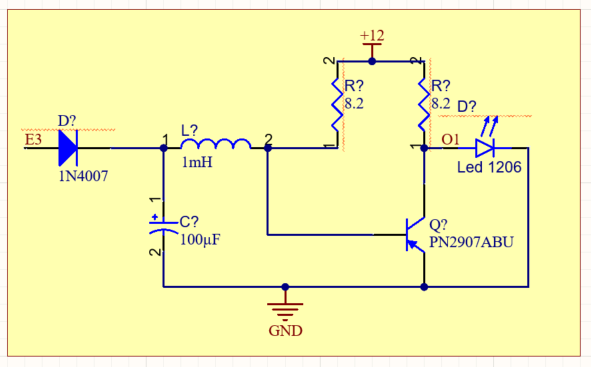{ width="600" }
*Figura 6.7.1: Circuito lógico interconectado mediante Etiquetas de Red.*

### Anotación Automática de Designadores
Al colocar componentes nuevos, Altium les asigna un signo de interrogación por defecto (R?, D?, C?). Si el diseño se exporta en este estado, el software generará un error fatal.

Para resolverlo, ejecutamos la herramienta de anotación automática:
1. Nos dirigimos al menú superior **`Tools`**.
2. Seleccionamos **`Annotation`**.
3. Hacemos clic en **`Annotate Schematics Quietly`**.

| Menú de Anotación | Circuito Final Numerado |
| :---: | :---: |
| 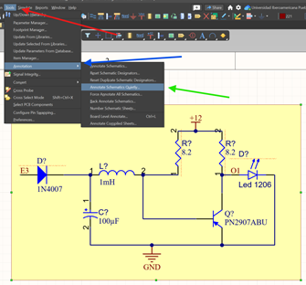{ width="300" } | 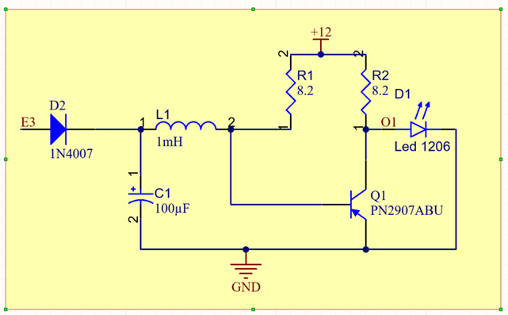{ width="450" } |

Esta acción asignará un número secuencial único a cada componente (D1, L1, R2, Q1). Con este paso completado, nuestro diagrama esquemático queda totalmente validado y listo para ser exportado al entorno de diseño físico de PCB.

---

## 6.8 Exportación al Entorno PCB

Con el esquemático finalizado, procedemos a crear el documento de la placa. En el panel lateral, hacemos clic derecho sobre el proyecto (`Placa_prueba.PrjPcb`), seleccionamos **`Add New to Project`** y elegimos **`PCB`**.

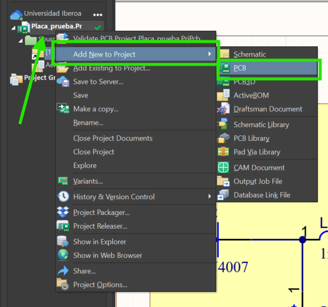{ width="400" }
*Figura 6.8.1: Ruta para generar el lienzo de ruteo físico de la tarjeta de circuito impreso.*
