# 6. Diseño Avanzado de PCB en Altium Designer

Altium Designer es una de las herramientas de automatización de diseño electrónico (EDA) más potentes y utilizadas a nivel industrial. En esta sección documentaremos el flujo de trabajo inicial, desde la configuración del entorno y licencias académicas, hasta la creación del proyecto y captura del diagrama esquemático.

---

## 6.1 Instalación y Configuración del Entorno

El primer paso para utilizar Altium Designer es instalar la suite y vincular la licencia correspondiente a nuestra institución.

### Descarga del Instalador
Para obtener el software, nos dirigimos al portal oficial de descargas de Altium. En la sección de Altium Designer, seleccionamos la opción de **Online Installer (exe)**, la cual se encargará de gestionar los paquetes necesarios durante la instalación.

{ width="700" }
*Figura 6.1.1: Portal oficial de descargas de Altium.*

### Gestión de Licencias
La primera vez que ejecutemos el programa, se mostrará el panel de administración de licencias (`License Management`). Para habilitar las herramientas de diseño, es necesario iniciar sesión y seleccionar una licencia activa. En este caso, seleccionaremos la licencia profesional institucional (indicada en el recuadro rojo) y haremos clic en el botón para activarla.

{ width="700" }
*Figura 6.1.2: Activación de la licencia institucional en el panel de Altium.*

### Conexión al Workspace Institucional
El último paso crítico antes de diseñar es vincular nuestro entorno con el espacio de trabajo en la nube de la universidad (Altium 365). 

Nos dirigimos a la esquina superior derecha de la interfaz. Si no estamos conectados, hacemos clic en el icono de usuario y seleccionamos **Unirse a un grupo**. Introducimos nuestro correo institucional, la contraseña asignada, y el código de verificación enviado al correo. Al finalizar, el indicador mostrará el estado de conexión activa.

{ width="450" }
*Figura 6.1.3: Verificación de conexión activa al Workspace universitario.*

---

## 6.2 Creación y Estructura del Proyecto

Altium Designer organiza los archivos mediante un archivo maestro de proyecto (`.PrjPcb`) que vincula lógicamente los esquemáticos y los diseños físicos de la placa.

### Inicialización del Proyecto
Para crear el directorio contenedor, nos dirigimos a la esquina superior izquierda y seleccionamos la ruta: **`File > New > Project...`**.

{ width="350" }
*Figura 6.2.1: Ruta de acceso para la creación de un nuevo proyecto.*

En la ventana de creación (`Create Project`), por defecto el sistema sugiere guardar el proyecto en la nube institucional. Si deseamos trabajarlo localmente, seleccionamos la opción de **Version Control** o **Local Projects**. Asignamos un nombre estructurado (por ejemplo, `Placa_prueba`) en el campo `Project Name` y hacemos clic en **Create**.

{ width="600" }
*Figura 6.2.2: Configuración de nombre y ubicación del proyecto.*

Una vez creado, en el panel lateral **`Projects`** aparecerá el contenedor principal identificado con el ícono verde característico (`.PrjPcb`).

{ width="300" }
*Figura 6.2.3: Contenedor del proyecto inicializado en el panel lateral.*

### Creación del Diagrama Esquemático
Para agregar nuestra primera hoja de diseño, hacemos clic derecho sobre el nombre del proyecto en el panel lateral, pasamos el cursor sobre **`Add New to Project`** y seleccionamos **`Schematic`**.

{ width="450" }
*Figura 6.2.4: Ruta para añadir un nuevo documento esquemático al proyecto.*

Al realizar esta acción, se generará una hoja en blanco y se abrirá el entorno de captura lógica. Es imperativo **guardar localmente el archivo**. Al notar que el documento tiene un ícono rojo en el panel (indicando que no está guardado), presionamos `Ctrl + S`, asignamos un nombre (`Placa_prueba.SchDoc`) y lo guardamos en nuestro directorio de trabajo.

| Guardado de Archivo | Explorador de Archivos |
| :---: | :---: |
| { width="300" } | { width="450" } |

{ width="650" }
*Figura 6.2.5: Interfaz del editor de esquemas listo para trabajar.*

---

## 6.3 Exploración de Paneles y Herramientas

Para trabajar de manera fluida, es necesario familiarizarse con la activación y el uso de los paneles de herramientas de Altium Designer.

### Paneles Laterales
En el borde derecho de la interfaz se encuentran pestañas de acceso rápido colapsadas por defecto (`Components`, `Properties`, etc.). El panel **`Components`** es la vía principal para buscar y colocar piezas desde librerías locales. 

Si por error cerramos algún panel lateral, podemos recuperarlo dirigiéndonos a la esquina inferior derecha, haciendo clic en el botón **`Panels`** y seleccionando el panel deseado.

| Panel Components | Recuperación de Paneles |
| :---: | :---: |
| { width="300" } | { width="300" } |

### Búsqueda Avanzada: Manufacturer Part Search
A diferencia de las librerías estáticas, Altium ofrece el panel **`Manufacturer Part Search`**. Esta herramienta se conecta en tiempo real con bases de datos globales de proveedores, permitiendo buscar cualquier componente mediante su matrícula o navegando por categorías.

{ width="350" }
*Figura 6.3.1: Interfaz de búsqueda global de componentes.*

### Activación de Barras de Herramientas Superiores
Para agilizar el proceso de dibujo, debemos activar las barras de acceso rápido. Al hacer clic derecho sobre el espacio vacío en la barra superior, desplegaremos un menú contextual.

Activamos la casilla **`Wiring`** (Cableado) para mostrar las herramientas de conexión eléctrica (cables, GND, VCC). También activamos **`Schematic Standard`**, **`Formatting`** y **`Utilities`** para habilitar las opciones de dibujo gráfico, zoom y guardado rápido.

{ width="700" }
*Figura 6.3.2: Configuración y habilitación de barras de herramientas superiores.*

---

## 6.4 Organización Visual del Esquemático

Para mantener un diseño profesional y ordenado, estructuraremos el lienzo en bloques funcionales utilizando herramientas de dibujo gráfico.

### Dibujo de Figuras Geométricas
En la barra de utilidades superior, desplegamos el menú del ícono de la regla y el lápiz. Esta herramienta nos permite dibujar formas (`Rectangle`, `Polyline`, `Ellipse`) que servirán como delimitadores visuales para distintas etapas del circuito (ej. entradas, salidas, potencia).

{ width="350" }
*Figura 6.4.1: Menú de formas geométricas y anotaciones.*

### Edición de Propiedades Visuales
Al trazar una figura y hacer doble clic sobre ella, se abrirá el panel **`Properties`**. Aquí podemos modificar el grosor de línea (`Line Size`), el color del borde y, activando la casilla `Fill Color`, asignar un color de fondo para resaltar el área.

| Trazo Inicial | Propiedades de Línea |
| :---: | :---: |
| { width="250" } | { width="350" } |
| **Propiedades de Relleno** | **Cuadro Terminado** |
| { width="350" } | { width="250" } |

### Etiquetado de Bloques
Para identificar cada área, seleccionamos la herramienta de texto (ícono de la letra "A") y la colocamos dentro de nuestro bloque. En el panel `Properties` del texto, ingresamos el nombre de la sección (ej. "Entradas") y ajustamos la fuente, tamaño, color y justificación.

{ width="550" }
*Figura 6.4.2: Bloque funcional delimitado e identificado profesionalmente.*

---

## 6.5 Selección y Verificación de Componentes

La correcta elección de componentes es el pilar de un buen diseño. En Altium, debemos garantizar que cada símbolo esquemático posea su representación física correspondiente.

### Búsqueda de Componentes en la Librería
Abrimos el panel **`Components`**. Podemos filtrar la búsqueda desplegando la lista de categorías (ej. `Connectors`, `Diodes`) o ingresando directamente la matrícula del componente en la barra de búsqueda superior.

| Filtrado por Categoría | Búsqueda por Matrícula |
| :---: | :---: |
| { width="300" } | { width="300" } |

### Verificación de Huella (Footprint) y Datasheet
Al seleccionar un componente de la lista, en la sección inferior `Details` se mostrarán sus propiedades técnicas.
1.  **Modelos 3D y Huellas:** Es obligatorio verificar en la sección `Models` que el componente cuente con su símbolo, huella de PCB y diseño 3D. Si carece de huella, no se podrá maquinar.
2.  **Hojas de Datos:** En la sección `References` o `Part Choices`, encontraremos enlaces directos al `Datasheet` en formato PDF. Al hacer clic, Altium abrirá el documento técnico del fabricante.

| Verificación de Huella | Enlace a Datasheet |
| :---: | :---: |
| { width="300" } | { width="300" } |

{ width="500" }
*Figura 6.5.1: Hoja de datos del fabricante para consulta de distribución de pines.*

### Solución a Componentes sin Huella (SnapMagic)
Si el componente deseado no incluye una huella en las librerías predeterminadas, podemos recurrir a repositorios CAD externos como **SnapMagic Search**. Esta plataforma permite descargar gratuitamente el símbolo, huella y modelo 3D en formato nativo para integrarlo a Altium.

| Modelo 3D Ausente/Básico | Plataforma SnapMagic |
| :---: | :---: |
| { width="300" } | { width="450" } |

---

## 6.6 Emplazamiento y Ruteo Lógico

Con los componentes verificados, procedemos a armar el esquema del circuito eléctrico.

### Acomodo y Rotación
Arrastramos los componentes desde el panel al área de trabajo. Para rotar un componente $90^\circ$, lo seleccionamos con un clic y presionamos la barra espaciadora. Ubicamos estratégicamente los elementos en el lienzo.

{ width="600" }
*Figura 6.6.1: Distribución preliminar de los componentes en el lienzo.*

### Trazado de Conexiones (Wires)
Para interconectar los elementos, activamos el modo de cableado haciendo clic en el ícono **`Place Wire`** (en la barra `Wiring`) o usando el atajo `Ctrl + W`. Al acercar el cursor a la terminal de un componente, aparecerá una cruz roja indicando un nodo válido. 

| Herramienta Place Wire | Detección de Nodo (Cruz Roja) |
| :---: | :---: |
| { width="400" } | { width="300" } |

### Puertos de Alimentación (Power Ports)
Para conectar las referencias de energía, localizamos el ícono de Tierra en la barra de cableado. Haciendo clic derecho sobre él, desplegamos el menú completo de opciones de voltaje.

| Menú de Puertos | Opciones de Alimentación |
| :---: | :---: |
| { width="350" } | { width="250" } |

{ width="500" }
*Figura 6.6.2: Consolidación del circuito con nodos de VCC y GND.*

---

## 6.7 Etiquetas de Red (Net Labels) y Anotación

Para evitar un exceso de cables cruzando todo el diseño, utilizaremos variables de interconexión inalámbrica.

### Implementación de Net Labels
En la barra de herramientas, hacemos clic derecho sobre el ícono de alambre y seleccionamos **`Net Label`**. Colocamos la etiqueta asegurándonos de que su punto de anclaje toque la línea del cable de destino.

| Selección de Herramienta | Edición de Nombre |
| :---: | :---: |
| { width="300" } | { width="300" } |
| **Lista de Redes Predefinidas** | **Conector Etiquetado** |
| { width="300" } | { width="300" } |

{ width="600" }
*Figura 6.7.1: Circuito lógico interconectado mediante Etiquetas de Red.*

### Anotación Automática de Designadores
Al colocar componentes nuevos, Altium les asigna un signo de interrogación por defecto (R?, D?, C?). Para resolverlo, ejecutamos la herramienta de anotación automática: **`Tools > Annotation > Annotate Schematics Quietly`**.

| Menú de Anotación | Circuito Final Numerado |
| :---: | :---: |
| { width="350" } | { width="500" } |

---

## 6.8 Exportación al Entorno PCB

Con el esquemático finalizado, procedemos a crear el documento de la placa. En el panel lateral, hacemos clic derecho sobre el proyecto (`Placa_prueba.PrjPcb`), seleccionamos **`Add New to Project`** y elegimos **`PCB`**.

{ width="450" }
*Figura 6.8.1: Ruta para generar el lienzo de ruteo físico de la tarjeta de circuito impreso.*

---

## 6.9 Agregar Documento PCB y Transferencia

En este apartado se realiza lo siguiente:

**Agregar documento PCB:**
En el panel lateral izquierdo `Projects`, se hace clic derecho sobre el archivo contenedor del proyecto (`Placa_prueba.PrjPcb`, indicado con la flecha verde). En el menú contextual, se pasa el cursor sobre `Add New to Project` y se selecciona la opción `PCB` (resaltada en el recuadro verde de la derecha). 

**Guardado del archivo de circuito impreso:** 
Se abrirá un lienzo de trabajo negro correspondiente al diseño de la placa. Inmediatamente, se debe guardar el nuevo archivo mediante `Ctrl + S` (o `File > Save`), asignándole un nombre dentro de la misma carpeta del proyecto (por ejemplo, `Placa_prueba.PcbDoc`). 

**Estructura completa:** 
Con este paso, el panel de proyectos contará con los dos documentos fundamentales vinculados: el esquemático (`.SchDoc`) y la placa PCB (`.PcbDoc`), preparados para la transferencia de componentes y huellas.

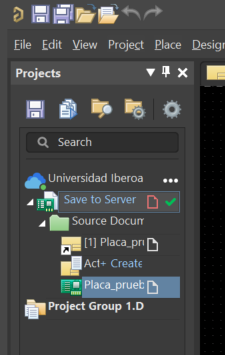
*Figura 6.9.1: Creación del documento PCB.*

  

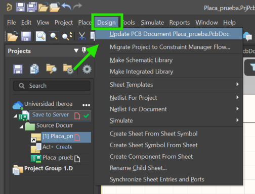
*Figura 6.9.2: Menú para actualizar el documento PCB con los datos del esquemático.*

  

---

## 6.10 Validación y Transferencia de Datos (ECO)

En este apartado se realiza la validación y transferencia de datos considerando lo siguiente:

*   **Advertencia de compilación:** En la parte inferior izquierda se observa una leyenda en texto rojo (resaltada con el recuadro verde): *"Warning: Errors occurred during compilation of the project!"*. Esta advertencia puede aparecer si alguna etiqueta de red no tiene un destino explícito o si existe alguna pequeña inconsistencia de conexión.
*   **Validación de cambios (Validate Changes):** Antes de volcar los componentes a la placa, se debe hacer clic en el botón `Validate Changes` (resaltado en el recuadro rojo inferior). Esto verifica que todas las huellas, componentes (C1, D1, D2, L1, P1, Q1, R1, R2) y redes (+12, E1, E2, E3, GND) estén listos y disponibles.
*   **Ejecución de cambios (Execute Changes):** Una vez que aparezcan las marcas verdes de verificación en la columna Check, se habilita el botón `Execute Changes` (indicado por la flecha azul). Al presionarlo, el sistema transferirá automáticamente todas las huellas y conexiones físicas al lienzo de la PCB, tras lo cual se presiona el botón Close para cerrar la ventana.

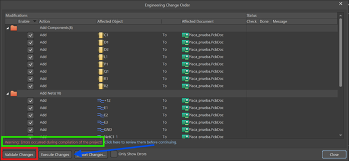
*Figura 6.10.1: Ventana de Engineering Change Order (ECO).*

  

---

## 6.11 Establecer el Origen del Circuito

En estas imágenes se ilustra el primer paso tras importar los componentes al entorno de PCB (`.PcbDoc`), así como la configuración del origen de referencia (0,0). En este apartado se realizan las siguientes acciones explicadas en la clase:

**Organización preliminar de las huellas:** 
Una vez ejecutada la orden ECO, los componentes importados (Q1, C1, L1, D2, D1, P1, R1, R2) se posicionan dentro del área de trabajo negra. En esta vista preliminar se observan las líneas finas de conexión (*ratsnest*), las cuales indican las conexiones eléctricas lógicas que deberán rutearse posteriormente. Para rotar cualquier componente mientras se arrastra con el clic izquierdo, se debe mantener presionado el clic y pulsar la barra espaciadora.

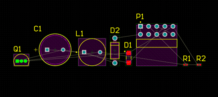
*Figura 6.11.1: Componentes y líneas ratsnest importados a la PCB.*

  

**Establecer el origen del circuito (Set Origin):** 
Para facilitar las mediciones, el ruteado y las reglas de fabricación, se define el punto de origen (0,0) en la esquina de la placa:
1. En la barra de menús superior, se hace clic en `Edit` (resaltado en el recuadro rojo de la segunda imagen). 
2. Se desplaza el cursor sobre `Origin` y se selecciona la opción `Set` (indicada por la flecha roja). 
3. El puntero del mouse cambiará a una cruz de precisión; con ella, se hace clic exactamente en la esquina inferior izquierda del borde negro de la PCB (resaltada dentro del círculo rojo de la tercera imagen).

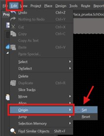
*Figura 6.11.2: Ruta para establecer el origen.*

  

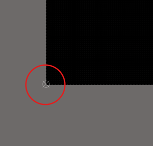
*Figura 6.11.3: Clic de precisión en la esquina inferior izquierda.*

  

---

## 6.12 Organización Funcional y Vista 3D

En este apartado se consideran las siguientes acciones y atajos explicados en la clase:

**Organización funcional del layout (Vista 2D):**
Como se aprecia al comparar la primera y segunda captura, los componentes se distribuyen estratégicamente sobre el lienzo negro. Se rotan y acomodan para minimizar el cruce de las líneas finas de conexión (*ratsnest*). Para rotar un elemento durante el arrastre con el clic izquierdo, se presiona la barra espaciadora.

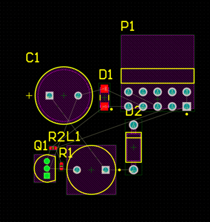
*Figura 6.12.1: Acomodo preliminar de componentes.*

  

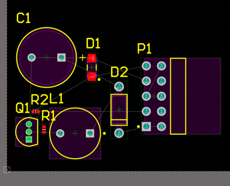
*Figura 6.12.2: Distribución optimizada para el ruteo.*

  

**Conmutación a la vista 3D:**
Para verificar la disposición física de los componentes y comprobar la altura o interferencias mecánicas, se presiona la tecla `3`. El lienzo cambiará a una representación tridimensional fotorrealista de la PCB (tercera imagen). Para regresar al plano bidimensional de ruteado (2D), simplemente se presiona la tecla `2`.

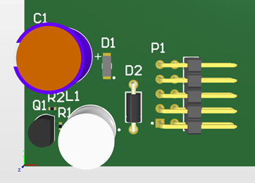
*Figura 6.12.3: Representación en 3D de los componentes.*

  

**Navegación y rotación en el espacio 3D:**
Como se ilustra en la cuarta captura, al mantener presionada la tecla `Shift` y hacer clic derecho sobre el lienzo, aparece una esfera de orientación con flechas (ejes X, Y, Z). Moviendo el mouse en esta modalidad, se puede rotar libremente la placa en cualquier ángulo e inclinación para inspeccionar la tarjeta desde diversas perspectivas mecánicas.

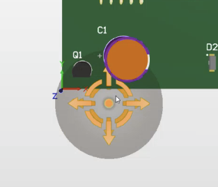
*Figura 6.12.4: Esfera de rotación en el visor 3D.*

  

---

## 6.13 Despliegue de Barras en el Entorno PCB

En este apartado se consideran los siguientes aspectos explicados durante la sesión:

*   **Despliegue de barras en el entorno PCB:** Al hacer clic derecho sobre el área libre de la barra de menús superior dentro de la pestaña de la PCB (`Placa_prueba.PcbDoc`), se despliega el menú contextual de barras de herramientas.
*   **Barra PCB Standard:** Al marcar la casilla `PCB Standard`, se habilita la barra superior dedicada al ruteado. Esta incluye las herramientas de trazado de pistas (Interactive Routing), colocación de vías, polígonos de cobre, arcos, reglas de medición y textos para capas del circuito impreso.
*   **Barras Utilities, Filter y Wiring:** Al mantener activadas las casillas `Utilities`, `Filter` y `Wiring`, se integran los accesos directos para la selección de elementos por filtros, opciones de zoom, edición visual y botones de navegación rápida dentro de la tarjeta de circuito impreso.

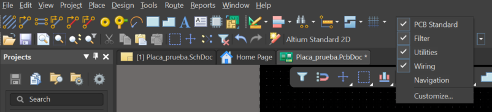
*Figura 6.13.1: Menú contextual para habilitar barras de herramientas.*

  

---

## 6.14 Filtro de Redes y Aislamiento Visual

En estas capturas se ilustra el procedimiento para aislar e identificar visualmente las conexiones pertenecientes a un nodo o red específica (como +12, GND o E1) dentro de la tarjeta. En este apartado se consideran las siguientes acciones explicadas en la clase:

*   **Uso del menú desplegable de redes:** En la barra de herramientas superior de la PCB, se localiza el menú desplegable de filtro de redes (resaltado con el recuadro rojo en la primera imagen). Al dar clic sobre él, se muestra el listado completo de los nodos del circuito (+12, E1, E2, E3, GND, NetC1_1, NetL1_2, O1).
*   **Aislamiento y resaltado visual (Dim Mode):** Al seleccionar una red en particular (por ejemplo, +12), el entorno atenúa o oscurece en tono gris todos los componentes y pistas que no pertenecen a esa red, manteniendo iluminados únicamente los pads y conexiones de la red seleccionada (segunda imagen).
*   **Facilidad para el ruteado:** Esta herramienta resulta sumamente útil para identificar rápidamente los puntos de destino antes de trazar pistas manuales, evitando confusiones en circuitos con alta densidad de conexiones.

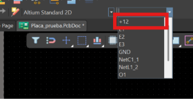
*Figura 6.14.1: Despliegue del filtro de redes.*

  

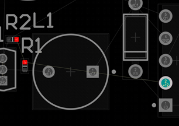
*Figura 6.14.2: Modo de resaltado visual (Dim Mode) para la red +12.*

  

---

## 6.15 Resolución de Errores de Diseño (DRC)

**Paso 24: Identificación y resolución de errores de reglas de diseño (DRC - Clearances y Violaciones)**

En esta captura se ilustra la representación visual de los errores de reglas de diseño (Design Rule Check - DRC) que surgen durante la colocación de componentes en el lienzo de la PCB. En este apartado se consideran las siguientes causas y soluciones explicadas en la clase:

**Identificación de infracciones (Marcas verdes y cruzadas):**
*   Cuando un componente o pad se ilumina en color verde brillante con pequeñas cruces (como el pin 1 GND de la imagen), Altium indica que se está violando una regla de diseño (Clearance Constraint o colisión física).
*   Las cotas en color amarillo que marcan `< 10mil` señalan que la distancia entre los pads adyacentes (O1, NetL1_2 y GND) es menor que la separación mínima permitida por las reglas de fabricación predeterminadas.

**Causas comunes:**
*   Proximidad excesiva entre componentes o encapsulados pequeños (como transistores o conectores).
*   Superposición de capas de serigrafía (Silkscreen) o bordes del cuerpo del componente sobre las zonas de soldadura.

**Formas de solución:**
*   **Reorganización manual:** Separar ligeramente los componentes arrastrándolos con el cursor hasta que la marca verde desaparezca y el pad recupere su color normal.
*   **Ajuste de reglas de diseño (Rules):** Si las dimensiones del componente son correctas según su datasheet, se puede ingresar al menú `Design > Rules > Clearance` para reducir el margen mínimo de separación (por ejemplo, ajustándolo a 6 mil u 8 mil) según la capacidad del fabricante de la PCB.

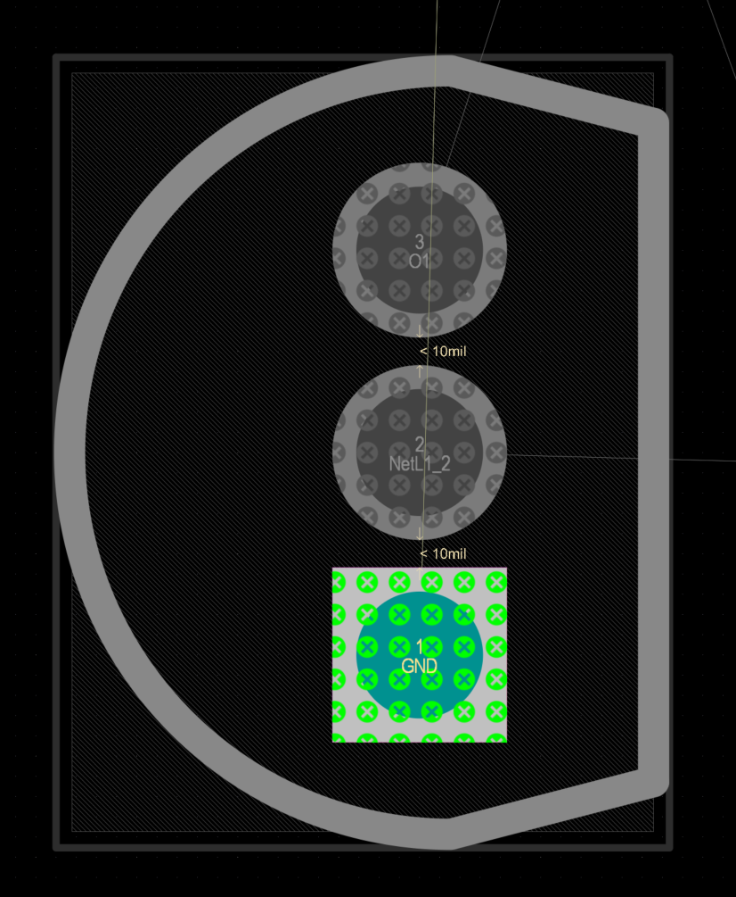
*Figura 6.15.1: Violaciones de reglas de diseño visualizadas en el lienzo.*

  

---

## 6.16 Sistema de Medición y Atajos

En este apartado se consideran los siguientes detalles técnicos explicados en la clase:

**Atajo de teclado "Q":** Al presionar la tecla `Q` en cualquier momento dentro del lienzo de la PCB, Altium Designer conmuta el sistema de medición activo entre unidades métricas (mm) e imperiales (mils o milésimas de pulgada).

*   **Modo Métrico (mm):** Como se observa en la primera imagen, la visualización de coordenadas (x, y, dx, dy) y la rejilla de captura (Snap) se muestran en milímetros (por ejemplo, Snap: 0.127mm). Este sistema es ideal para definir dimensiones mecánicas de la placa y posicionar conectores con paso métrico.
*   **Modo Imperial (mils):** Al volver a pulsar la tecla `Q` (segunda imagen), las lecturas cambian automáticamente a milésimas de pulgada (por ejemplo, Snap: 5mil, dx: 15.000mil). Este sistema es el estándar industrial para especificar anchos de pista, separaciones de aislamiento (clearances) y footprints con distribución de pines basada en 100 mil (2.54 mm).

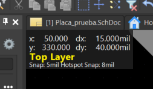
*Figura 6.16.1: Lecturas en unidades imperiales (Mils).*

  

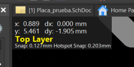
*Figura 6.16.2: Lecturas en unidades métricas (mm).*

  

---

## 6.17 Importación de Reglas de Diseño (Rules)

En estas capturas se detalla el proceso para abrir el editor de reglas de diseño (Design Rules) e importar un archivo de reglas preconfigurado según los estándares de manufactura de un fabricante (como JLCPCB). En este apartado se consideran los siguientes pasos explicados durante la sesión:

**Acceso al editor de reglas (PCB Rules and Constraints Editor):**
1. En la barra de menús superior dentro del documento PCB, se hace clic en la pestaña `Design` (indicada por la flecha roja en la primera imagen).
2. En el menú desplegable, se selecciona la opción `Rules...` (resaltada en el recuadro rojo). Esto desplegará la ventana emergente PCB Rules and Constraints Editor (segunda imagen), donde se listan todas las categorías de diseño (Electrical, Routing, SMT, Manufacturing, Placement, etc.).

**Importar reglas del fabricante (Import Rules):**
1. Dentro del árbol de navegación izquierdo en la ventana de reglas, se hace clic derecho sobre el directorio principal `Default Rule Set` (resaltado en el recuadro rojo superior de la tercera imagen).
2. En el menú contextual, se selecciona la opción `Import Rules...` (resaltada en el recuadro rojo inferior).

**Carga del archivo de reglas (JLCPCB.rul):**
Se abrirá el explorador de archivos de Windows (cuarta imagen), en el cual se navega hasta ubicar el archivo con extensión `.rul` proporcionado por la casa de fabricación (por ejemplo, `JLCPCB.rul`). Al cargarlo y confirmar la sobreescritura/actualización, Altium ajustará automáticamente los grosores mínimos de pista, separaciones (clearances), diámetros de vía y tolerancias a las capacidades reales de la máquina de producción del fabricante, eliminando falsas alertas de error en la placa.

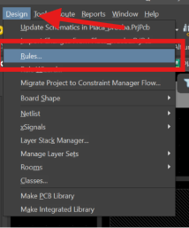
*Figura 6.17.1: Acceso a Design > Rules.*

  

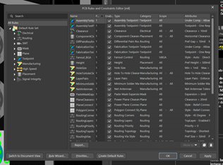
*Figura 6.17.2: Ventana PCB Rules and Constraints Editor.*

  

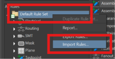
*Figura 6.17.3: Opción Import Rules desde el árbol de navegación.*

  

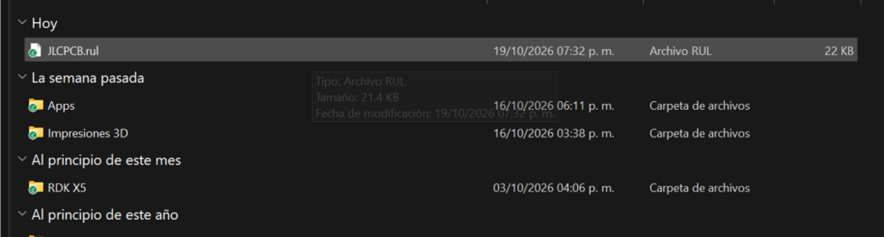
*Figura 6.17.4: Archivo de reglas JLCPCB.rul en el explorador.*

  

---

## 6.18 Ajuste Manual de Ancho de Pista

En esta captura se muestra cómo ajustar las reglas de ancho de pista (Width) de forma manual directamente desde el PCB Rules and Constraints Editor. En este apartado se consideran las siguientes acciones para configurar las reglas manualmente:

*   **Edición directa por regla (Width):** En lugar de importar un archivo `.rul`, se puede navegar en el menú de la izquierda hacia la categoría `Routing > Width`. Al seleccionar la regla (en este caso, Width), se despliegan sus parámetros en el panel central.
*   **Ajuste de parámetros en la tabla de capas (Constraints):** Dentro de la sección de restricciones (Constraints), se pueden modificar los valores celda por celda para las diferentes capas de la placa (Top Layer, Bottom Layer):
    *   **Min Width (Ancho mínimo):** Define el grosor mínimo de pista permitido por el fabricante o el diseño (por ejemplo, 0.24mil o 10 mil según la unidad configurada).
    *   **Preferred Width (Ancho preferido):** Es el valor por defecto que Altium utilizará al iniciar el ruteado interactivo de las pistas (por ejemplo, 0.254mil / 10 mil / 0.25 mm).
    *   **Max Width (Ancho máximo):** Limita el grosor máximo al que se puede expandir una pista en esta regla.
*   **Aplicación de cambios:** Al modificar manualmente estos campos y presionar `Apply` y `OK`, Altium actualizará los límites de ruteado sin necesidad de depender de un archivo externo.

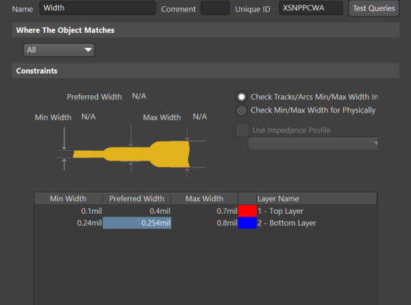
*Figura 6.18.1: Configuración de la regla de ancho de pista.*

  

---

## 6.19 Ruteo Interactivo y Ancho Dinámico

En estas capturas se ilustra el inicio del trazado físico de las pistas sobre la PCB, así como la técnica para modificar dinámicamente el grosor de la línea mientras se realiza el ruteado. En este apartado se consideran los siguientes aspectos clave expuestos en la clase:

**Estrategia de ruteado (GND al final):** 
Como buena práctica de diseño, la red de tierra (GND) se suele dejar para el final. Esto se debe a que habitualmente se cubre la placa con un plano o vertido de cobre (Polygon Pour) conectado a GND al terminar, el cual une automáticamente todos los pads de tierra. Por ello, se rutean primero las señales de datos, entradas, salidas y líneas de alimentación como +12.

**Activar el ruteado interactivo (Interactive Routing):**
Para comenzar a tirar pistas, se hace clic en el ícono de ruteado interactivo (indicado por la flecha roja en la primera imagen) o se utiliza el atajo de teclado `Ctrl + W` (o `P > T`). Al hacer clic sobre un pad de origen (como el pin 1 NetC1_1 del capacitor C1 en la segunda imagen), se genera la pista interactiva en color rojo (correspondiente a la capa superior o Top Layer) siguiendo el cursor.

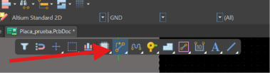
*Figura 6.19.1: Selección de la herramienta Interactive Routing.*

  

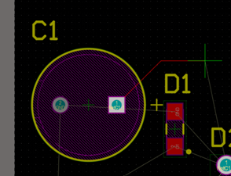
*Figura 6.19.2: Trazado interactivo desde un pad de origen.*

  

**Cambio dinámico de ancho de pista (Atajo Shift + W):**
Si durante el trazo de una línea se requiere cambiar su ancho (por ejemplo, para hacer más gruesa una pista de potencia o más delgada una de señal), se presiona la combinación de teclas `Shift + W`. 

Esto desplegará en pantalla la ventana emergente `Choose Width` (tercera imagen), permitiendo seleccionar de forma rápida un valor predefinido en milésimas de pulgada (10 mil, 12 mil, 20 mil, etc.) o en milímetros (0.25 mm, 0.5 mm, etc.) sin necesidad de interrumpir el ruteado o regresar al menú de reglas.

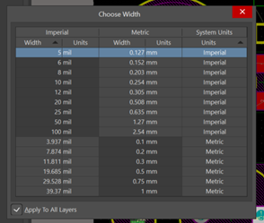
*Figura 6.19.3: Menú desplegable para el ajuste dinámico del grosor de pista.*

  

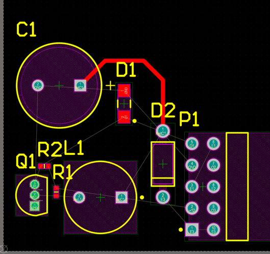
*Figura 6.19.4: Ruteado completado de la pista seleccionada.*

  

---

## 6.20 Modalidades de Ruteado Automático

En este apartado se explican las tres modalidades principales:

**1. Ruteado automático de toda la placa (Auto Route All):**
*   **Procedimiento:** Se hace clic en `Route > Auto Route > All...` (indicado con la flecha roja en la primera imagen).
*   **Resultado:** El sistema intenta trazar de forma autónoma la totalidad de las pistas del circuito sobre las capas disponibles (Top Layer en rojo y Bottom Layer en azul), como se observa en la segunda captura. Aunque es una función rápida, habitualmente requiere ajustes manuales posteriores para optimizar caminos o evitar ángulos inadecuados.

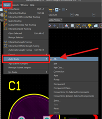
*Figura 6.20.1: Selección de ruteado automático completo.*

  

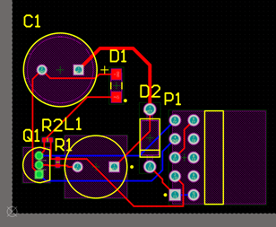
*Figura 6.20.2: Pistas generadas por el auto ruteador global.*

  

**2. Ruteado automático por red (Auto Route Net):**
*   **Procedimiento:** Se navega a `Route > Auto Route > Net` (indicado por la flecha verde en la tercera imagen) y se selecciona un nodo específico sobre la placa.
*   **Resultado:** Altium rutea únicamente la red seleccionada (por ejemplo, la red que conecta el capacitor C1 con el diodo D1), dejando las demás conexiones pendientes (cuarta imagen).

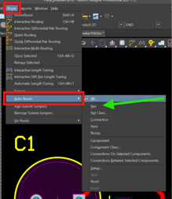
*Figura 6.20.3: Selección de ruteado automático por red específica.*

  

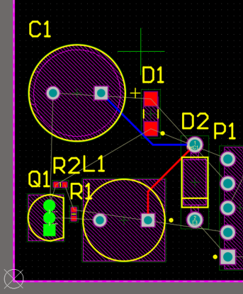
*Figura 6.20.4: Pista ruteada automáticamente sobre el nodo seleccionado.*

  

**3. Ruteado automático por área (Auto Route Area):**
*   **Procedimiento:** Se selecciona `Route > Auto Route > Area` (flecha azul en la quinta imagen) y se dibuja un recuadro sobre una zona concreta de la placa.
*   **Resultado:** El motor de ruteado procesa e interconecta únicamente los componentes y pads contenidos dentro del área seleccionada (como la sección del transistor Q1 y las resistencias R1, R2 en la sexta imagen). 

Estas opciones de ruteado selectivo son útiles para delegar partes repetitivas del trazo mientras mantienes el control manual sobre las pistas críticas de alimentación o señal.

*Figura 6.20.5: Selección de ruteado por área.*

  

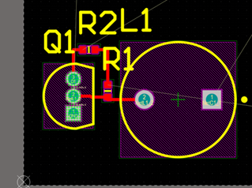
*Figura 6.20.6: Pistas generadas solo en el área delimitada.*

  

---

## 6.21 Definición de Contorno de Placa (Board Shape)

Para definir el corte mecánico exacto que tendrá la placa de circuito impreso, utilizaremos la capa de dibujo mecánico para crear un polígono y recortar el área excedente.

Cambiamos a la pestaña de la capa **`Mechanical 1`** y seleccionamos la herramienta de dibujo de línea (`Place Line`). Trazamos un contorno cerrado (color magenta) alrededor de nuestros componentes para delimitar la geometría final. Una vez trazado, seleccionamos estas líneas, nos dirigimos al menú superior y hacemos clic en **`Design > Board Shape > Define Board Shape from Selected Objects`**.

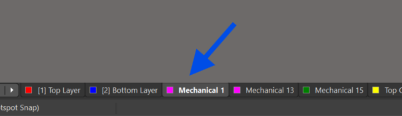
*Figura 6.21.1: Selección de la capa Mechanical 1.*

  

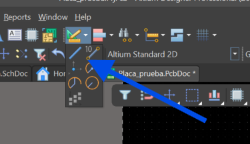
*Figura 6.21.2: Herramienta Place Line activada.*

  

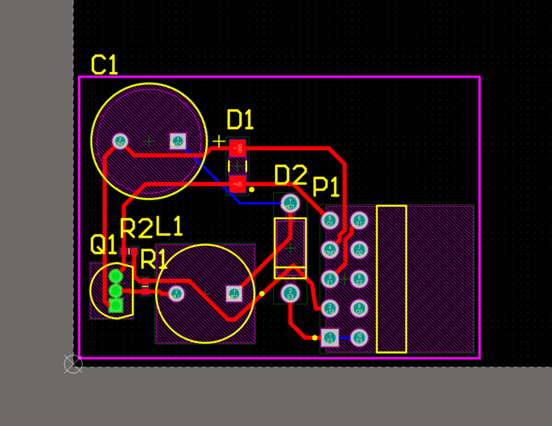
*Figura 6.21.3: Contorno físico de la placa delimitado.*

  

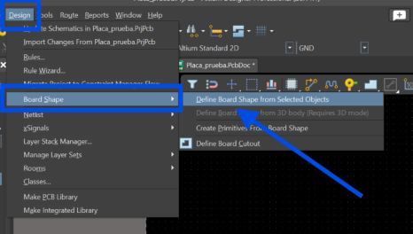
*Figura 6.21.4: Herramienta Define Board Shape from Selected Objects.*

  

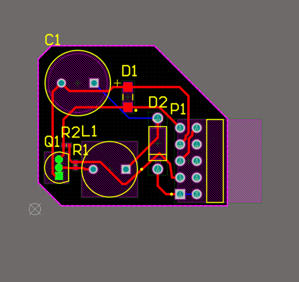
*Figura 6.21.5: Tarjeta recortada con sus nuevas dimensiones físicas.*

  

---

## 6.22 Inspección Tridimensional Final

**Paso 31: Inspección tridimensional final y verificación mecánica de la tarjeta**

En esta captura se aprecia la tarjeta finalizada en la vista tridimensional fotorrealista (3D View), recortada exactamente según el contorno personalizado definido en el paso anterior. En este apartado se consideran los siguientes puntos de verificación final:

*   **Inspección de volumetría y colisiones físicas:** Al presionar la tecla `3` e inspeccionar la placa en 3D, se valida que todos los componentes (capacitor electrolítico C1, inductor L1, transistor Q1, diodos D1/D2, conector P1 y resistencias) cuenten con su modelo 3D correctamente alineado sobre sus pads de soldadura.
*   **Verificación de orientación y altura:** Permite comprobar que conectores de ángulo recto como P1 sobresalgan adecuadamente hacia el borde de la placa para su posterior ensamble o acople mecánico en un chasis.
*   **Validación de serigrafía (Silkscreen):** Se confirma la visibilidad de los designadores (C1, Q1, R1, R2, L1, D1, D2, P1) e indicativos de polaridad (como la banda blanca y signo + del capacitor) sobre la capa de máscara superior.

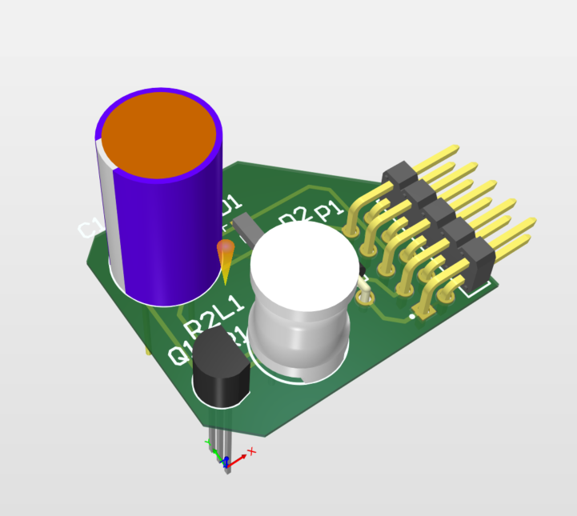
*Figura 6.22.1: Modelo tridimensional final de la tarjeta de circuito impreso validada.*
