# 6. Diseño Avanzado de PCB en Altium Designer

Altium Designer es una de las herramientas de automatización de diseño electrónico (EDA) más potentes y utilizadas a nivel industrial. En esta sección documentaremos el flujo de trabajo inicial, desde la configuración del entorno y licencias académicas, hasta la creación del proyecto y captura del diagrama esquemático.

---

## 6.1 Instalación y Configuración del Entorno

### Descarga del Instalador
Este es el link donde podemos descargar Altium: [Descargar Altium Designer](https://www.altium.com/products/downloads?srsltid=AU7gw4XECxHxSmIM7cCQc7f9E6-Uy8oNcmDMetrjfxTbEvQaKlSs0ehy). Aparecen 2 opciones de instalación (el ejecutable o instalado); para que sea más directo, solo le damos clic a donde está el recuadro rojo (`Online Installer`).

*Figura 6.1.1: Opciones de descarga en la página oficial.*

  

### Gestión de Licencias
La primera vez que lo abramos se verá algo así. Hay que seleccionar la licencia (en este caso la que está dentro del recuadro rojo) para que se nos habilite poder ocupar el programa.

*Figura 6.1.2: Activación de la licencia en el License Management.*

  

### Conexión a la Red Universitaria
El último paso para empezar a diseñar las placas es ver que estemos dentro de la red universitaria. En la esquina superior derecha podremos encontrar si estamos conectados o no; en caso de que no, le damos clic y seleccionamos "Unir a un grupo". Ahí pondremos nuestro correo universitario y la contraseña que nos llegó al correo. Después pedirá un código de verificación enviado al mismo correo, lo ingresamos y listo, debe verse como en la imagen.

*Figura 6.1.3: Verificación de conexión al Workspace de la Universidad.*

---

## 6.2 Creación y Estructura del Proyecto

### Creación de la Carpeta del Proyecto
Para comenzar nuestro proyecto crearemos la carpeta en donde guardaremos todos nuestros archivos. Le damos a `File` ubicado en la esquina superior izquierda (apuntado con la flecha roja), después a `New` (apuntado con la flecha azul) y después le damos a `Project` (apuntado con la flecha verde).

*Figura 6.2.1: Menú para la creación de un nuevo proyecto.*

  

Por default se guardará en la nube de nuestro correo institucional, pero en caso de tener instalado Altium en nuestro equipo le damos a `Version control` y en el recuadro azul podremos cambiar el nombre de nuestro proyecto. Una vez teniendo el nombre y la ubicación de nuestro proyecto, le damos a `Create`.

*Figura 6.2.2: Configuración de nombre y ubicación.*

  

Una vez asignado el nombre al proyecto (como se muestra en la imagen con `Placa_prueba.PrjPcb`), se creará el contenedor principal identificado con el ícono verde de proyecto. En este apartado se organiza el espacio de trabajo antes de agregar las hojas de esquemático o los archivos de PCB.

*Figura 6.2.3: Contenedor del proyecto inicializado.*

  

### Añadir la Hoja de Esquemático
En esta parte se muestra cómo añadir la primera hoja de diseño dentro de la estructura que se creó en el paso anterior. Para crear el esquemático, se da clic derecho sobre el nombre del proyecto en el panel lateral izquierdo de `Projects`. En el menú desplegable que aparece, se pasa el cursor sobre la opción `Add New to Project` y se selecciona `Schematic`. 

*Figura 6.2.4: Agregar nuevo Schematic al proyecto.*

  

Al hacer esto, se creará un archivo nuevo con el símbolo de esquema dentro de la estructura del proyecto y se abrirá el lienzo en blanco para comenzar a colocar los componentes electrónicos.

*Figura 6.2.5: Lienzo de diseño en blanco.*

  

### Guardado del Esquemático
De acuerdo con lo explicado en la clase, una vez creado el documento, se debe guardar localmente en la carpeta de trabajo asignada. En el panel lateral `Projects`, el documento aparece marcado con un ícono rojo. Esto indica que el archivo aún no se ha guardado localmente en el disco duro. 

Para guardarlo, se selecciona la hoja, se presiona `Ctrl + S` (o `File > Save`) y se asigna una ubicación dentro de la carpeta del proyecto.

*Figura 6.2.6: Indicador rojo de archivo sin guardar.*

  

*Figura 6.2.7: Ventana de guardado local.*

---

## 6.3 Exploración de Paneles Laterales y de Búsqueda

### Pestaña de Componentes (Components)
En el borde derecho de la interfaz se encuentran desplegadas las pestañas de acceso rápido a `Components`, `Comments and Tasks` y `Properties`. Como se explicó en la sesión, la pestaña de Components será la vía principal para buscar y desplegar las librerías en el área de dibujo.

*Figura 6.3.1: Panel de componentes estándar.*

  

En caso de llegar a cerrar la pestaña de componentes, podemos dirigirnos a la esquina inferior derecha donde está un apartado llamado `Panels`. Le damos clic, buscamos `Components` y le damos clic para tenerlo de nuevo. Lo mismo aplicaría si cerramos el panel lateral izquierdo, solo vamos a Panels y le damos a `Projects`.

*Figura 6.3.2: Botón de recuperación de paneles.*

  

### Manufacturer Part Search
En este apartado se consideran los siguientes aspectos explicados en la sesión:
*   **Búsqueda e importación directa:** A diferencia de las librerías locales, este panel se conecta en tiempo real con bases de datos globales de proveedores y fabricantes. Permite buscar componentes específicos mediante su matrícula o navegando por categorías (Passive Components, Connectors, etc.).
*   **Asegurar la huella (Footprint) y el modelo 3D:** Es fundamental utilizar este buscador para verificar que el componente cuente con el símbolo, la huella (PCB footprint) y su modelo 3D. Como destacó el profesor, si un componente no incluye su huella desde el catálogo, no se podrá exportar hacia el diseño final de la PCB.
*   **Acceso a hojas de datos:** El panel permite consultar de forma inmediata la hoja de datos (datasheet), especificaciones físicas y disponibilidad.

*Figura 6.3.3: Panel Manufacturer Part Search.*

---

## 6.4 Barras de Herramientas y Dibujo Gráfico

### Menú de Activación de Barras
Al dar clic derecho sobre el espacio vacío de la barra de menús superior, se despliega una lista contextual. Se debe activar la casilla **`Wiring`**; esto despliega el grupo de herramientas para colocar cables, tierras (GND), puertos de voltaje y Net Labels.

Al seleccionar opciones como **`Schematic Standard`**, **`Formatting`** o **`Utilities`**, se habilita la segunda barra. Esta contiene los íconos para guardar, hacer zoom, copiar y ajustar la visualización.

*Figura 6.4.1: Activación de las barras Wiring y Utilities.*

  

### Menú de Herramientas Gráficas
En la barra de utilidades se encuentra el menú desplegable del ícono de la regla y el lápiz. Contiene diversas formas geométricas y opciones de dibujo para organizar el diagrama por bloques funcionales. Dentro de este menú también se encuentra la herramienta de texto (letra "A").

*Figura 6.4.2: Opciones de figuras geométricas y texto.*

  

### Edición de Propiedades Visuales (Cuadros y Líneas)
Al hacer doble clic sobre cualquier figura creada, se despliega el panel `Properties` para modificarla:
*   **Líneas (Polyline):** Permite modificar el grosor (Line), el estilo del trazo (sólido, punteado) y los extremos.
*   **Bloques (Rectangle):** Se pueden definir sus dimensiones exactas (Width y Height), color del borde y activar la casilla `Fill Color` para asignarle un fondo de color (como el tono amarillo que se observa en el ejemplo). 

*Figura 6.4.3: Ajustes de grosor y estilo de línea.*

  

*Figura 6.4.4: Activación del color de relleno (Fill Color).*

  

*Figura 6.4.5: Bloque funcional dibujado y rellenado en amarillo.*

  

### Colocación de Texto Descriptivo
Para agregar una etiqueta de texto, se selecciona la herramienta de texto y se da clic sobre el área deseada dentro del cuadro. Al hacer doble clic sobre el texto, se modifica el campo `Text` (ej. "Entradas"). Dentro de la sección `Properties`, se pueden ajustar parámetros como la fuente, tamaño, alineación y estilo (negrita, cursiva, subrayado). De esta manera, el bloque queda identificado de forma clara.

*Figura 6.4.6: Ajuste de propiedades de texto.*

---

## 6.5 Búsqueda de Componentes y Consulta de Datasheet

### Filtrar por Familia
En el panel `Components`, se da clic en el menú desplegable de categorías para desplegar el listado de familias disponibles y seleccionar la deseada, como `Connectors` (Conectores).

*Figura 6.5.1: Despliegue de familias de componentes.*

  

### Búsqueda y Previsualización Técnica
Al escribir una matrícula o palabra clave en la barra de búsqueda (por ejemplo, `79`), el panel filtra los resultados. En la sección inferior `Details`, se muestran las especificaciones del encapsulado, el símbolo esquemático y la huella para la PCB (Footprint / Modelo 3D).

*Figura 6.5.2: Búsqueda específica de la matrícula.*

  

### Consulta de la Hoja de Datos (Datasheet)
Al desplegar la sección `References` o `Part Choices`, se encuentra el enlace al documento PDF del fabricante. Al hacer clic sobre el archivo (por ejemplo, `796136-1`), el sistema abre directamente en el navegador la hoja de datos técnica de Tyco Electronics.

*Figura 6.5.3: Enlace de referencia al PDF.*

  

*Figura 6.5.4: Datasheet original del fabricante abierto desde Altium.*

  

### Alternativas para Huellas Faltantes (SnapMagic)
Este es un aspecto crítico mencionado durante la clase: si un componente no incluye su huella integrada, no se podrá exportar. Si el componente deseado no incluye huella en las librerías, una solución rápida y eficiente es recurrir a plataformas como **SnapMagic Search** (anteriormente conocida como SnapEDA): [https://www.snapeda.com/](https://www.snapeda.com/).

Desde este sitio web se puede buscar la matrícula exacta del componente para descargar gratuitamente el símbolo, la huella y el modelo 3D en formato compatible con Altium Designer.

*Figura 6.5.5: Verificación de presencia de modelo 3D.*

  

*Figura 6.5.6: Plataforma SnapMagic para descarga de footprints externos.*

---

## 6.6 Emplazamiento y Herramientas de Cableado

### Arrastrar, Acomodar y Rotar Componentes
Una vez verificados los componentes, basta con hacer clic izquierdo sobre ellos y arrastrarlos hacia el área de trabajo. Para orientar un componente en la posición requerida para el cableado, se hace clic sobre él mientras está seleccionado y se presiona la **barra espaciadora** (esto lo girará en ángulos de 90°).

Se pueden ubicar los elementos estratégicamente. En este ejemplo, se coloca el conector (`68021-210HLF`) dentro del bloque amarillo delimitado previamente como "Entradas", mientras que el resto de los elementos se acomodan a un costado.

*Figura 6.6.1: Distribución estratégica de los componentes en la hoja.*

  

### Herramienta Place Wire
Para activar el modo de cableado, se puede hacer clic sobre el ícono de alambre o utilizar el atajo de teclado **`Ctrl + W`** (o presionar la tecla W).

Al desplazar el cursor sobre la terminal de un componente, el puntero cambiará a una **cruz roja**. Esto indica que se ha detectado un nodo válido. Se debe hacer clic izquierdo sobre la primera terminal, arrastrar el trazo (siguiendo trayectorias a 90° o 45°) y hacer clic de nuevo sobre la terminal final para consolidar la unión. (Para salir del modo de cableado se presiona Esc).

*Figura 6.6.2: Ícono de la herramienta Place Wire.*

  

*Figura 6.6.3: Identificación de nodos mediante cruz roja.*

---

## 6.7 Puertos de Alimentación y Net Labels

### Agregar Alimentación (+12V) y Tierra (GND)
En la barra flotante de herramientas superiores, se localiza el ícono del símbolo de tierra. Al hacer clic derecho sobre este ícono, se desplegará una lista con todas las opciones de Power Ports.

*   **Tierra (GND):** Se selecciona `Place GND power port` y se posiciona en el nodo común inferior del circuito.
*   **Voltaje (+12V):** Se selecciona `Place +12 power port` y se conecta en el punto superior donde se unen las resistencias. Con esto, todas las etapas quedan debidamente referenciadas.

*Figura 6.7.1: Menú desplegable de puertos de alimentación.*

  

*Figura 6.7.2: Circuito consolidado con nodos de +12V y GND.*

  

### Colocación de Net Labels
En la barra de herramientas flotante, se hace clic derecho sobre el ícono de cableado y se selecciona la opción **`Net Label`**. Al desplazar la etiqueta, debe asegurarse de que el pequeño punto blanco de origen toque la línea de conexión.

Al hacer doble clic sobre la etiqueta colocada (o desde el panel Properties), se modifica el campo `Net Name` para asignar un identificador (ej. E1, E2, O1, +12, GND). 

*Figura 6.7.3: Selección de la herramienta Net Label.*

  

*Figura 6.7.4: Modificación del nombre de la red.*

  

### Conexión Lógica en Conectores
Si la etiqueta ya fue definida anteriormente, el menú desplegable del campo permite seleccionarla. Al colocar las etiquetas en los pines del conector de entradas, estos quedan interconectados eléctricamente con el resto del circuito sin necesidad de tirar líneas que crucen toda la hoja.

*Figura 6.7.5: Conector etiquetado para interconexión virtual.*

  

*Figura 6.7.6: Circuito completo con Net Labels aplicadas.*

---

## 6.8 Anotación de Designadores y Exportación a PCB

### Anotar y Numerar Designadores (Annotate Schematics)
Como se observa en el circuito, los componentes colocados inicialmente tienen un signo de interrogación en su designador (R?, D?, C?). Si se dejan así, el sistema no podrá exportar la PCB.

En la barra de menús superior, se selecciona la opción **`Tools`**, se desplaza el cursor sobre **`Annotation`** y se hace clic en **`Annotate Schematics Quietly`**.

*Figura 6.8.1: Ruta para ejecutar la anotación automática.*

  

Altium asignará automáticamente un número secuencial a cada componente (D2, L1, C1, R1, etc.). De esta forma, el esquemático queda totalmente validado.

*Figura 6.8.2: Circuito con numeración secuencial finalizada.*

  

### Añadir Documento PCB
Para transferirlo al diseño físico, hacemos clic derecho sobre el proyecto en el panel lateral, seleccionamos **`Add New to Project`** y elegimos **`PCB`**.

*Figura 6.8.3: Creación del documento PCB para iniciar el ruteo.*

---

## 6.9 Guardado y Sincronización del Documento PCB

En este apartado se realiza lo siguiente:

**Guardado del archivo de circuito impreso:** 
Se abrirá un lienzo de trabajo negro correspondiente al diseño de la placa. Inmediatamente, se debe guardar el nuevo archivo mediante `Ctrl + S` (o `File > Save`), asignándole un nombre dentro de la misma carpeta del proyecto (por ejemplo, `Placa_prueba.PcbDoc`). 

Estructura completa: Con este paso, el panel de proyectos contará con los dos documentos fundamentales vinculados: el esquemático (`.SchDoc`) y la placa PCB (`.PcbDoc`), preparados para la transferencia de componentes y huellas.

*Figura 6.9.1: Guardado local del nuevo archivo PCB.*

  

**Actualización del documento PCB:**
En la barra de menú, nos dirigimos a `Design > Update PCB Document Placa_prueba.PcbDoc`. Esta es la herramienta encargada de sincronizar la información y los componentes desde el esquemático hacia la placa física.

*Figura 6.9.2: Menú para actualizar el documento PCB con los datos del esquemático.*

  

### Validación y Transferencia de Datos (ECO)
En este apartado se realiza la validación y transferencia de datos considerando lo siguiente:

*   **Advertencia de compilación:** En la parte inferior izquierda se observa una leyenda en texto rojo: *"Warning: Errors occurred during compilation of the project!"*. Esta advertencia puede aparecer si alguna etiqueta de red no tiene un destino explícito o si existe alguna pequeña inconsistencia de conexión.
*   **Validación de cambios (Validate Changes):** Antes de volcar los componentes a la placa, se debe hacer clic en el botón `Validate Changes` (resaltado en el recuadro rojo inferior). Esto verifica que todas las huellas y redes estén listos y disponibles.
*   **Ejecución de cambios (Execute Changes):** Una vez que aparezcan las marcas verdes de verificación, se habilita el botón `Execute Changes` (indicado por la flecha azul). Al presionarlo, el sistema transferirá automáticamente todas las huellas y conexiones físicas al lienzo de la PCB.

*Figura 6.9.3: Ventana de Engineering Change Order (ECO).*

---

## 6.10 Origen y Distribución Preliminar

En estas imágenes se ilustra el primer paso tras importar los componentes al entorno de PCB (`.PcbDoc`), así como la configuración del origen de referencia (0,0). 

**Organización preliminar de las huellas:** 
Una vez ejecutada la orden ECO, los componentes importados se posicionan dentro del área de trabajo negra. En esta vista preliminar se observan las líneas finas de conexión (*ratsnest*), las cuales indican las conexiones eléctricas lógicas que deberán rutearse posteriormente. Para rotar cualquier componente mientras se arrastra con el clic izquierdo, se debe mantener presionado el clic y pulsar la barra espaciadora.

*Figura 6.10.1: Componentes y líneas ratsnest importados a la PCB.*

  

**Establecer el origen del circuito (Set Origin):** 
Para facilitar las mediciones, el ruteado y las reglas de fabricación, se define el punto de origen (0,0) en la esquina de la placa:
1. En la barra de menús superior, se hace clic en `Edit`. 
2. Se desplaza el cursor sobre `Origin` y se selecciona la opción `Set` (indicada por la flecha roja). 
3. El puntero del mouse cambiará a una cruz de precisión; con ella, se hace clic exactamente en la esquina inferior izquierda del borde negro de la PCB.

*Figura 6.10.2: Ruta para establecer el origen.*

  

*Figura 6.10.3: Clic de precisión en la esquina inferior izquierda.*

---

## 6.11 Organización Funcional y Vista 3D

En este apartado se consideran las siguientes acciones y atajos explicados en la clase:

**Organización funcional del layout (Vista 2D):**
Los componentes se distribuyen estratégicamente sobre el lienzo negro. Se rotan y acomodan para minimizar el cruce de las líneas finas de conexión (*ratsnest*).

*Figura 6.11.1: Acomodo preliminar de componentes.*

  

*Figura 6.11.2: Distribución optimizada para el ruteo.*

  

**Conmutación a la vista 3D:**
Para verificar la disposición física de los componentes y comprobar la altura o interferencias mecánicas, se presiona la tecla `3`. El lienzo cambiará a una representación tridimensional fotorrealista de la PCB. Para regresar al plano bidimensional de ruteado (2D), simplemente se presiona la tecla `2`.

*Figura 6.11.3: Representación en 3D de los componentes.*

  

**Navegación y rotación en el espacio 3D:**
Al mantener presionada la tecla `Shift` y hacer clic derecho sobre el lienzo, aparece una esfera de orientación con flechas. Moviendo el mouse en esta modalidad, se puede rotar libremente la placa en cualquier ángulo e inclinación para inspeccionar la tarjeta desde diversas perspectivas mecánicas.

*Figura 6.11.4: Esfera de rotación en el visor 3D.*

---

## 6.12 Entorno PCB: Barras, Filtros y Unidades

En este apartado se consideran los siguientes aspectos explicados durante la sesión:

**Despliegue de barras en el entorno PCB:** 
Al hacer clic derecho sobre el área libre de la barra de menús superior dentro de la pestaña de la PCB, se despliega el menú contextual de barras de herramientas.

*   **Barra PCB Standard:** Al marcar la casilla `PCB Standard`, se habilita la barra superior dedicada al ruteado. 
*   **Barras Utilities, Filter y Wiring:** Al mantener activadas las casillas `Utilities`, `Filter` y `Wiring`, se integran los accesos directos para la selección de elementos por filtros, opciones de zoom, edición visual y botones de navegación rápida.

*Figura 6.12.1: Menú contextual para habilitar barras de herramientas.*

  

### Filtro de Redes y Aislamiento Visual
En estas capturas se ilustra el procedimiento para aislar e identificar visualmente las conexiones pertenecientes a un nodo o red específica (como +12, GND o E1) dentro de la tarjeta.

*   **Uso del menú desplegable de redes:** En la barra de herramientas superior de la PCB, se localiza el menú desplegable de filtro de redes. Al dar clic sobre él, se muestra el listado completo de los nodos del circuito.
*   **Aislamiento y resaltado visual (Dim Mode):** Al seleccionar una red en particular (por ejemplo, +12), el entorno atenúa o oscurece en tono gris todos los componentes y pistas que no pertenecen a esa red, manteniendo iluminados únicamente los pads y conexiones de la red seleccionada.

*Figura 6.12.2: Despliegue del filtro de redes.*

  

*Figura 6.12.3: Modo de resaltado visual (Dim Mode) para la red +12.*

  

### Identificación y Resolución de Errores de Diseño (DRC)
En esta captura se ilustra la representación visual de los errores de reglas de diseño que surgen durante la colocación de componentes en el lienzo de la PCB.

*   **Identificación de infracciones:** Cuando un componente o pad se ilumina en color verde brillante con pequeñas cruces, Altium indica que se está violando una regla de diseño (Clearance Constraint o colisión física). Las cotas en color amarillo que marcan `< 10mil` señalan que la distancia entre los pads adyacentes es menor que la separación mínima permitida.
*   **Formas de solución:** Reorganización manual separando ligeramente los componentes arrastrándolos con el cursor hasta que la marca verde desaparezca, o ajuste de reglas de diseño en `Design > Rules > Clearance`.

*Figura 6.12.4: Violaciones de reglas de diseño visualizadas en el lienzo.*

  

### Sistema de Medición (Atajo Q)
**Atajo de teclado "Q":** Al presionar la tecla `Q` en cualquier momento dentro del lienzo de la PCB, Altium Designer conmuta el sistema de medición activo entre unidades métricas (mm) e imperiales (mils o milésimas de pulgada).

*   **Modo Imperial (mils):** Las lecturas cambian automáticamente a milésimas de pulgada (por ejemplo, Snap: 5mil). Este sistema es el estándar industrial para especificar anchos de pista, separaciones de aislamiento (clearances) y footprints con distribución de pines basada en 100 mil (2.54 mm).
*   **Modo Métrico (mm):** La visualización de coordenadas y la rejilla de captura (Snap) se muestran en milímetros. Este sistema es ideal para definir dimensiones mecánicas de la placa y posicionar conectores con paso métrico.

*Figura 6.12.5: Lecturas en unidades imperiales (Mils).*

  

*Figura 6.12.6: Lecturas en unidades métricas (mm).*

---

## 6.13 Importación de Reglas de Diseño (Rules)

En estas capturas se detalla el proceso para abrir el editor de reglas de diseño (Design Rules) e importar un archivo de reglas preconfigurado según los estándares de manufactura de un fabricante (como JLCPCB). 

**Acceso al editor de reglas:**
En la barra de menús superior dentro del documento PCB, se hace clic en la pestaña `Design` y se selecciona la opción `Rules...` Esto desplegará la ventana emergente PCB Rules and Constraints Editor.

*Figura 6.13.1: Acceso a Design > Rules.*

  

*Figura 6.13.2: Ventana PCB Rules and Constraints Editor.*

  

**Importar reglas del fabricante (Import Rules):**
1. Dentro del árbol de navegación izquierdo en la ventana de reglas, se hace clic derecho sobre el directorio principal `Default Rule Set`.
2. En el menú contextual, se selecciona la opción `Import Rules...`

*Figura 6.13.3: Opción Import Rules desde el árbol de navegación.*

  

**Carga del archivo de reglas (JLCPCB.rul):**
Se abrirá el explorador de archivos de Windows, en el cual se navega hasta ubicar el archivo con extensión `.rul` proporcionado por la casa de fabricación (por ejemplo, `JLCPCB.rul`). Al cargarlo y confirmar la sobreescritura/actualización, Altium ajustará automáticamente los grosores mínimos de pista, separaciones, diámetros de vía y tolerancias a las capacidades reales de la máquina de producción.

*Figura 6.13.4: Archivo de reglas JLCPCB.rul en el explorador.*

  

### Ajuste Manual de Ancho de Pista (Width)
En esta captura se muestra cómo ajustar las reglas de ancho de pista (Width) de forma manual directamente desde el PCB Rules and Constraints Editor. 

*   **Edición directa por regla (Width):** En lugar de importar un archivo `.rul`, se puede navegar en el menú de la izquierda hacia la categoría `Routing > Width`. 
*   **Ajuste de parámetros en la tabla de capas (Constraints):** Se pueden modificar los valores celda por celda para las diferentes capas de la placa:
    *   **Min Width (Ancho mínimo):** Define el grosor mínimo de pista permitido (por ejemplo, 0.24mil o 10 mil).
    *   **Preferred Width (Ancho preferido):** Es el valor por defecto que Altium utilizará al iniciar el ruteado interactivo de las pistas.
    *   **Max Width (Ancho máximo):** Limita el grosor máximo al que se puede expandir una pista en esta regla.

*Figura 6.13.5: Configuración de la regla de ancho de pista.*

---

## 6.14 Ruteo Interactivo y Ancho Dinámico

En estas capturas se ilustra el inicio del trazado físico de las pistas sobre la PCB, así como la técnica para modificar dinámicamente el grosor de la línea mientras se realiza el ruteado.

**Estrategia de ruteado (GND al final):** 
Como buena práctica de diseño, la red de tierra (GND) se suele dejar para el final. Esto se debe a que habitualmente se cubre la placa con un plano o vertido de cobre (Polygon Pour) conectado a GND al terminar, el cual une automáticamente todos los pads de tierra. Por ello, se rutean primero las señales de datos, entradas, salidas y líneas de alimentación como +12.

**Activar el ruteado interactivo (Interactive Routing):**
Para comenzar a tirar pistas, se hace clic en el ícono de ruteado interactivo o se utiliza el atajo de teclado `Ctrl + W` (o `P > T`). Al hacer clic sobre un pad de origen (como el pin 1 NetC1_1 del capacitor C1 en la segunda imagen), se genera la pista interactiva en color rojo (correspondiente a la capa superior o Top Layer) siguiendo el cursor.

*Figura 6.14.1: Selección de la herramienta Interactive Routing.*

  

*Figura 6.14.2: Trazado interactivo desde un pad de origen.*

  

**Cambio dinámico de ancho de pista (Atajo Shift + W):**
Si durante el trazo de una línea se requiere cambiar su ancho (por ejemplo, para hacer más gruesa una pista de potencia o más delgada una de señal), se presiona la combinación de teclas `Shift + W`. Esto desplegará en pantalla la ventana emergente `Choose Width` permitiendo seleccionar de forma rápida un valor predefinido en milésimas de pulgada o en milímetros sin necesidad de interrumpir el ruteado o regresar al menú de reglas.

*Figura 6.14.3: Menú desplegable para el ajuste dinámico del grosor de pista.*

  

*Figura 6.14.4: Ruteado completado de la pista seleccionada.*

---

## 6.15 Modalidades de Ruteado Automático

En este apartado se explican las tres modalidades principales:

**1. Ruteado automático de toda la placa (Auto Route All):**
*   **Procedimiento:** Se hace clic en `Route > Auto Route > All...`
*   **Resultado:** El sistema intenta trazar de forma autónoma la totalidad de las pistas del circuito sobre las capas disponibles (Top Layer en rojo y Bottom Layer en azul). Aunque es una función rápida, habitualmente requiere ajustes manuales posteriores para optimizar caminos o evitar ángulos inadecuados.

*Figura 6.15.1: Selección de ruteado automático completo.*

  

*Figura 6.15.2: Pistas generadas por el auto ruteador global.*

  

**2. Ruteado automático por red (Auto Route Net):**
*   **Procedimiento:** Se navega a `Route > Auto Route > Net` y se selecciona un nodo específico sobre la placa.
*   **Resultado:** Altium rutea únicamente la red seleccionada (por ejemplo, la red que conecta el capacitor C1 con el diodo D1), dejando las demás conexiones pendientes.

*Figura 6.15.3: Selección de ruteado automático por red específica.*

  

*Figura 6.15.4: Pista ruteada automáticamente sobre el nodo seleccionado.*

  

**3. Ruteado automático por área (Auto Route Area):**
*   **Procedimiento:** Se selecciona `Route > Auto Route > Area` y se dibuja un recuadro sobre una zona concreta de la placa.
*   **Resultado:** El motor de ruteado procesa e interconecta únicamente los componentes y pads contenidos dentro del área seleccionada (como la sección del transistor Q1 y las resistencias R1, R2). Estas opciones de ruteado selectivo son útiles para delegar partes repetitivas del trazo mientras mantienes el control manual sobre las pistas críticas de alimentación o señal.

*Figura 6.15.5: Selección de ruteado por área.*

  

*Figura 6.15.6: Pistas generadas solo en el área delimitada.*

---

## 6.16 Definición de Contorno de Placa (Board Shape)

Para definir el corte mecánico exacto que tendrá la placa de circuito impreso, utilizaremos la capa de dibujo mecánico para crear un polígono y recortar el área excedente.

1.  Se cambia a la capa mecánica (`Mechanical 1`, indicada por la flecha azul).
2.  Se utiliza la herramienta de dibujo de línea (`Place Line`) para dibujar un polígono cerrado alrededor de los componentes, delimitando físicamente el tamaño personalizado que tendrá la placa de circuito impreso.
3.  Una vez que el contorno violeta está completamente cerrado (como se muestra en la tercera imagen), se seleccionan todas las líneas del polígono mecánico que se acaba de dibujar.
4.  Con las líneas seleccionadas, se navega en la barra superior a `Design > Board Shape > Define Board Shape from Selected Objects` (cuarta imagen). Al dar clic, el fondo oscuro del entorno de Altium se ajustará y recortará exactamente a la forma del polígono trazado (quinta imagen), eliminando el área excedente y definiendo la geometría real de la PCB.

*Figura 6.16.1: Selección de la capa Mechanical 1.*

  

*Figura 6.16.2: Herramienta Place Line activada.*

  

*Figura 6.16.3: Contorno físico de la placa delimitado.*

  

*Figura 6.16.4: Herramienta Define Board Shape from Selected Objects.*

  

*Figura 6.16.5: Tarjeta recortada con las dimensiones mecánicas personalizadas.*

---

## 6.17 Inspección Tridimensional Final

**Paso 31: Inspección tridimensional final y verificación mecánica de la tarjeta**

En esta captura se aprecia la tarjeta finalizada en la vista tridimensional fotorrealista (3D View), recortada exactamente según el contorno personalizado definido en el paso anterior. En este apartado se consideran los siguientes puntos de verificación final:

*   **Inspección de volumetría y colisiones físicas:** Al presionar la tecla `3` e inspeccionar la placa en 3D, se valida que todos los componentes (capacitor electrolítico C1, inductor L1, transistor Q1, diodos D1/D2, conector P1 y resistencias) cuenten con su modelo 3D correctamente alineado sobre sus pads de soldadura.
*   **Verificación de orientación y altura:** Permite comprobar que conectores de ángulo recto como P1 sobresalgan adecuadamente hacia el borde de la placa para su posterior ensamble o acople mecánico en un chasis.
*   **Validación de serigrafía (Silkscreen):** Se confirma la visibilidad de los designadores (C1, Q1, R1, R2, L1, D1, D2, P1) e indicativos de polaridad (como la banda blanca y signo + del capacitor) sobre la capa de máscara superior.

*Figura 6.17.1: Modelo tridimensional final de la tarjeta de circuito impreso validada.*

## 6.9 Agregar Documento PCB y Transferencia

En este apartado se realiza lo siguiente:

**Agregar documento PCB:**
En el panel lateral izquierdo `Projects`, se hace clic derecho sobre el archivo contenedor del proyecto (`Placa_prueba.PrjPcb`, indicado con la flecha verde). En el menú contextual, se pasa el cursor sobre `Add New to Project` y se selecciona la opción `PCB` (resaltada en el recuadro verde de la derecha). 

**Guardado del archivo de circuito impreso:** 
Se abrirá un lienzo de trabajo negro correspondiente al diseño de la placa. Inmediatamente, se debe guardar el nuevo archivo mediante `Ctrl + S` (o `File > Save`), asignándole un nombre dentro de la misma carpeta del proyecto (por ejemplo, `Placa_prueba.PcbDoc`). 

**Estructura completa:** 
Con este paso, el panel de proyectos contará con los dos documentos fundamentales vinculados: el esquemático (`.SchDoc`) y la placa PCB (`.PcbDoc`), preparados para la transferencia de componentes y huellas.

*Figura 6.9.1: Creación del documento PCB.*

  

*Figura 6.9.2: Menú para actualizar el documento PCB con los datos del esquemático.*

  

---

## 6.10 Validación y Transferencia de Datos (ECO)

En este apartado se realiza la validación y transferencia de datos considerando lo siguiente:

*   **Advertencia de compilación:** En la parte inferior izquierda se observa una leyenda en texto rojo (resaltada con el recuadro verde): *"Warning: Errors occurred during compilation of the project!"*. Esta advertencia puede aparecer si alguna etiqueta de red no tiene un destino explícito o si existe alguna pequeña inconsistencia de conexión.
*   **Validación de cambios (Validate Changes):** Antes de volcar los componentes a la placa, se debe hacer clic en el botón `Validate Changes` (resaltado en el recuadro rojo inferior). Esto verifica que todas las huellas, componentes (C1, D1, D2, L1, P1, Q1, R1, R2) y redes (+12, E1, E2, E3, GND) estén listos y disponibles.
*   **Ejecución de cambios (Execute Changes):** Una vez que aparezcan las marcas verdes de verificación en la columna Check, se habilita el botón `Execute Changes` (indicado por la flecha azul). Al presionarlo, el sistema transferirá automáticamente todas las huellas y conexiones físicas al lienzo de la PCB, tras lo cual se presiona el botón Close para cerrar la ventana.

*Figura 6.10.1: Ventana de Engineering Change Order (ECO).*

  

---

## 6.11 Establecer el Origen del Circuito

En estas imágenes se ilustra el primer paso tras importar los componentes al entorno de PCB (`.PcbDoc`), así como la configuración del origen de referencia (0,0). En este apartado se realizan las siguientes acciones explicadas en la clase:

**Organización preliminar de las huellas:** 
Una vez ejecutada la orden ECO, los componentes importados (Q1, C1, L1, D2, D1, P1, R1, R2) se posicionan dentro del área de trabajo negra. En esta vista preliminar se observan las líneas finas de conexión (*ratsnest*), las cuales indican las conexiones eléctricas lógicas que deberán rutearse posteriormente. Para rotar cualquier componente mientras se arrastra con el clic izquierdo, se debe mantener presionado el clic y pulsar la barra espaciadora.

*Figura 6.11.1: Componentes y líneas ratsnest importados a la PCB.*

  

**Establecer el origen del circuito (Set Origin):** 
Para facilitar las mediciones, el ruteado y las reglas de fabricación, se define el punto de origen (0,0) en la esquina de la placa:
1. En la barra de menús superior, se hace clic en `Edit` (resaltado en el recuadro rojo de la segunda imagen). 
2. Se desplaza el cursor sobre `Origin` y se selecciona la opción `Set` (indicada por la flecha roja). 
3. El puntero del mouse cambiará a una cruz de precisión; con ella, se hace clic exactamente en la esquina inferior izquierda del borde negro de la PCB (resaltada dentro del círculo rojo de la tercera imagen).

*Figura 6.11.2: Ruta para establecer el origen.*

  

*Figura 6.11.3: Clic de precisión en la esquina inferior izquierda.*

  

---

## 6.12 Organización Funcional y Vista 3D

En este apartado se consideran las siguientes acciones y atajos explicados en la clase:

**Organización funcional del layout (Vista 2D):**
Como se aprecia al comparar la primera y segunda captura, los componentes se distribuyen estratégicamente sobre el lienzo negro. Se rotan y acomodan para minimizar el cruce de las líneas finas de conexión (*ratsnest*). Para rotar un elemento durante el arrastre con el clic izquierdo, se presiona la barra espaciadora.

*Figura 6.12.1: Acomodo preliminar de componentes.*

  

*Figura 6.12.2: Distribución optimizada para el ruteo.*

  

**Conmutación a la vista 3D:**
Para verificar la disposición física de los componentes y comprobar la altura o interferencias mecánicas, se presiona la tecla `3`. El lienzo cambiará a una representación tridimensional fotorrealista de la PCB (tercera imagen). Para regresar al plano bidimensional de ruteado (2D), simplemente se presiona la tecla `2`.

*Figura 6.12.3: Representación en 3D de los componentes.*

  

**Navegación y rotación en el espacio 3D:**
Como se ilustra en la cuarta captura, al mantener presionada la tecla `Shift` y hacer clic derecho sobre el lienzo, aparece una esfera de orientación con flechas (ejes X, Y, Z). Moviendo el mouse en esta modalidad, se puede rotar libremente la placa en cualquier ángulo e inclinación para inspeccionar la tarjeta desde diversas perspectivas mecánicas.

*Figura 6.12.4: Esfera de rotación en el visor 3D.*

  

---

## 6.13 Despliegue de Barras en el Entorno PCB

En este apartado se consideran los siguientes aspectos explicados durante la sesión:

*   **Despliegue de barras en el entorno PCB:** Al hacer clic derecho sobre el área libre de la barra de menús superior dentro de la pestaña de la PCB (`Placa_prueba.PcbDoc`), se despliega el menú contextual de barras de herramientas.
*   **Barra PCB Standard:** Al marcar la casilla `PCB Standard`, se habilita la barra superior dedicada al ruteado. Esta incluye las herramientas de trazado de pistas (Interactive Routing), colocación de vías, polígonos de cobre, arcos, reglas de medición y textos para capas del circuito impreso.
*   **Barras Utilities, Filter y Wiring:** Al mantener activadas las casillas `Utilities`, `Filter` y `Wiring`, se integran los accesos directos para la selección de elementos por filtros, opciones de zoom, edición visual y botones de navegación rápida dentro de la tarjeta de circuito impreso.

*Figura 6.13.1: Menú contextual para habilitar barras de herramientas.*

  

---

## 6.14 Filtro de Redes y Aislamiento Visual

En estas capturas se ilustra el procedimiento para aislar e identificar visualmente las conexiones pertenecientes a un nodo o red específica (como +12, GND o E1) dentro de la tarjeta. En este apartado se consideran las siguientes acciones explicadas en la clase:

*   **Uso del menú desplegable de redes:** En la barra de herramientas superior de la PCB, se localiza el menú desplegable de filtro de redes (resaltado con el recuadro rojo en la primera imagen). Al dar clic sobre él, se muestra el listado completo de los nodos del circuito (+12, E1, E2, E3, GND, NetC1_1, NetL1_2, O1).
*   **Aislamiento y resaltado visual (Dim Mode):** Al seleccionar una red en particular (por ejemplo, +12), el entorno atenúa o oscurece en tono gris todos los componentes y pistas que no pertenecen a esa red, manteniendo iluminados únicamente los pads y conexiones de la red seleccionada (segunda imagen).
*   **Facilidad para el ruteado:** Esta herramienta resulta sumamente útil para identificar rápidamente los puntos de destino antes de trazar pistas manuales, evitando confusiones en circuitos con alta densidad de conexiones.

*Figura 6.14.1: Despliegue del filtro de redes.*

  

*Figura 6.14.2: Modo de resaltado visual (Dim Mode) para la red +12.*

  

---

## 6.15 Resolución de Errores de Diseño (DRC)

**Paso 24: Identificación y resolución de errores de reglas de diseño (DRC - Clearances y Violaciones)**

En esta captura se ilustra la representación visual de los errores de reglas de diseño (Design Rule Check - DRC) que surgen durante la colocación de componentes en el lienzo de la PCB. En este apartado se consideran las siguientes causas y soluciones explicadas en la clase:

**Identificación de infracciones (Marcas verdes y cruzadas):**
*   Cuando un componente o pad se ilumina en color verde brillante con pequeñas cruces (como el pin 1 GND de la imagen), Altium indica que se está violando una regla de diseño (Clearance Constraint o colisión física).
*   Las cotas en color amarillo que marcan `< 10mil` señalan que la distancia entre los pads adyacentes (O1, NetL1_2 y GND) es menor que la separación mínima permitida por las reglas de fabricación predeterminadas.

**Causas comunes:**
*   Proximidad excesiva entre componentes o encapsulados pequeños (como transistores o conectores).
*   Superposición de capas de serigrafía (Silkscreen) o bordes del cuerpo del componente sobre las zonas de soldadura.

**Formas de solución:**
*   **Reorganización manual:** Separar ligeramente los componentes arrastrándolos con el cursor hasta que la marca verde desaparezca y el pad recupere su color normal.
*   **Ajuste de reglas de diseño (Rules):** Si las dimensiones del componente son correctas según su datasheet, se puede ingresar al menú `Design > Rules > Clearance` para reducir el margen mínimo de separación (por ejemplo, ajustándolo a 6 mil u 8 mil) según la capacidad del fabricante de la PCB.

*Figura 6.15.1: Violaciones de reglas de diseño visualizadas en el lienzo.*

  

---

## 6.16 Sistema de Medición y Atajos

En este apartado se consideran los siguientes detalles técnicos explicados en la clase:

**Atajo de teclado "Q":** Al presionar la tecla `Q` en cualquier momento dentro del lienzo de la PCB, Altium Designer conmuta el sistema de medición activo entre unidades métricas (mm) e imperiales (mils o milésimas de pulgada).

*   **Modo Métrico (mm):** Como se observa en la primera imagen, la visualización de coordenadas (x, y, dx, dy) y la rejilla de captura (Snap) se muestran en milímetros (por ejemplo, Snap: 0.127mm). Este sistema es ideal para definir dimensiones mecánicas de la placa y posicionar conectores con paso métrico.
*   **Modo Imperial (mils):** Al volver a pulsar la tecla `Q` (segunda imagen), las lecturas cambian automáticamente a milésimas de pulgada (por ejemplo, Snap: 5mil, dx: 15.000mil). Este sistema es el estándar industrial para especificar anchos de pista, separaciones de aislamiento (clearances) y footprints con distribución de pines basada en 100 mil (2.54 mm).

*Figura 6.16.1: Lecturas en unidades imperiales (Mils).*

  

*Figura 6.16.2: Lecturas en unidades métricas (mm).*

  

---

## 6.17 Importación de Reglas de Diseño (Rules)

En estas capturas se detalla el proceso para abrir el editor de reglas de diseño (Design Rules) e importar un archivo de reglas preconfigurado según los estándares de manufactura de un fabricante (como JLCPCB). En este apartado se consideran los siguientes pasos explicados durante la sesión:

**Acceso al editor de reglas (PCB Rules and Constraints Editor):**
1. En la barra de menús superior dentro del documento PCB, se hace clic en la pestaña `Design` (indicada por la flecha roja en la primera imagen).
2. En el menú desplegable, se selecciona la opción `Rules...` (resaltada en el recuadro rojo). Esto desplegará la ventana emergente PCB Rules and Constraints Editor (segunda imagen), donde se listan todas las categorías de diseño (Electrical, Routing, SMT, Manufacturing, Placement, etc.).

**Importar reglas del fabricante (Import Rules):**
1. Dentro del árbol de navegación izquierdo en la ventana de reglas, se hace clic derecho sobre el directorio principal `Default Rule Set` (resaltado en el recuadro rojo superior de la tercera imagen).
2. En el menú contextual, se selecciona la opción `Import Rules...` (resaltada en el recuadro rojo inferior).

**Carga del archivo de reglas (JLCPCB.rul):**
Se abrirá el explorador de archivos de Windows (cuarta imagen), en el cual se navega hasta ubicar el archivo con extensión `.rul` proporcionado por la casa de fabricación (por ejemplo, `JLCPCB.rul`). Al cargarlo y confirmar la sobreescritura/actualización, Altium ajustará automáticamente los grosores mínimos de pista, separaciones (clearances), diámetros de vía y tolerancias a las capacidades reales de la máquina de producción del fabricante, eliminando falsas alertas de error en la placa.

*Figura 6.17.1: Acceso a Design > Rules.*

  

*Figura 6.17.2: Ventana PCB Rules and Constraints Editor.*

  

*Figura 6.17.3: Opción Import Rules desde el árbol de navegación.*

  

*Figura 6.17.4: Archivo de reglas JLCPCB.rul en el explorador.*

  

---

## 6.18 Ajuste Manual de Ancho de Pista

En esta captura se muestra cómo ajustar las reglas de ancho de pista (Width) de forma manual directamente desde el PCB Rules and Constraints Editor. En este apartado se consideran las siguientes acciones para configurar las reglas manualmente:

*   **Edición directa por regla (Width):** En lugar de importar un archivo `.rul`, se puede navegar en el menú de la izquierda hacia la categoría `Routing > Width`. Al seleccionar la regla (en este caso, Width), se despliegan sus parámetros en el panel central.
*   **Ajuste de parámetros en la tabla de capas (Constraints):** Dentro de la sección de restricciones (Constraints), se pueden modificar los valores celda por celda para las diferentes capas de la placa (Top Layer, Bottom Layer):
    *   **Min Width (Ancho mínimo):** Define el grosor mínimo de pista permitido por el fabricante o el diseño (por ejemplo, 0.24mil o 10 mil según la unidad configurada).
    *   **Preferred Width (Ancho preferido):** Es el valor por defecto que Altium utilizará al iniciar el ruteado interactivo de las pistas (por ejemplo, 0.254mil / 10 mil / 0.25 mm).
    *   **Max Width (Ancho máximo):** Limita el grosor máximo al que se puede expandir una pista en esta regla.
*   **Aplicación de cambios:** Al modificar manualmente estos campos y presionar `Apply` y `OK`, Altium actualizará los límites de ruteado sin necesidad de depender de un archivo externo.

*Figura 6.18.1: Configuración de la regla de ancho de pista.*

  

---

## 6.19 Ruteo Interactivo y Ancho Dinámico

En estas capturas se ilustra el inicio del trazado físico de las pistas sobre la PCB, así como la técnica para modificar dinámicamente el grosor de la línea mientras se realiza el ruteado. En este apartado se consideran los siguientes aspectos clave expuestos en la clase:

**Estrategia de ruteado (GND al final):** 
Como buena práctica de diseño, la red de tierra (GND) se suele dejar para el final. Esto se debe a que habitualmente se cubre la placa con un plano o vertido de cobre (Polygon Pour) conectado a GND al terminar, el cual une automáticamente todos los pads de tierra. Por ello, se rutean primero las señales de datos, entradas, salidas y líneas de alimentación como +12.

**Activar el ruteado interactivo (Interactive Routing):**
Para comenzar a tirar pistas, se hace clic en el ícono de ruteado interactivo (indicado por la flecha roja en la primera imagen) o se utiliza el atajo de teclado `Ctrl + W` (o `P > T`). Al hacer clic sobre un pad de origen (como el pin 1 NetC1_1 del capacitor C1 en la segunda imagen), se genera la pista interactiva en color rojo (correspondiente a la capa superior o Top Layer) siguiendo el cursor.

*Figura 6.19.1: Selección de la herramienta Interactive Routing.*

  

*Figura 6.19.2: Trazado interactivo desde un pad de origen.*

  

**Cambio dinámico de ancho de pista (Atajo Shift + W):**
Si durante el trazo de una línea se requiere cambiar su ancho (por ejemplo, para hacer más gruesa una pista de potencia o más delgada una de señal), se presiona la combinación de teclas `Shift + W`. 

Esto desplegará en pantalla la ventana emergente `Choose Width` (tercera imagen), permitiendo seleccionar de forma rápida un valor predefinido en milésimas de pulgada (10 mil, 12 mil, 20 mil, etc.) o en milímetros (0.25 mm, 0.5 mm, etc.) sin necesidad de interrumpir el ruteado o regresar al menú de reglas.

*Figura 6.19.3: Menú desplegable para el ajuste dinámico del grosor de pista.*

  

*Figura 6.19.4: Ruteado completado de la pista seleccionada.*

  

---

## 6.20 Modalidades de Ruteado Automático

En este apartado se explican las tres modalidades principales:

**1. Ruteado automático de toda la placa (Auto Route All):**
*   **Procedimiento:** Se hace clic en `Route > Auto Route > All...` (indicado con la flecha roja en la primera imagen).
*   **Resultado:** El sistema intenta trazar de forma autónoma la totalidad de las pistas del circuito sobre las capas disponibles (Top Layer en rojo y Bottom Layer en azul), como se observa en la segunda captura. Aunque es una función rápida, habitualmente requiere ajustes manuales posteriores para optimizar caminos o evitar ángulos inadecuados.

*Figura 6.20.1: Selección de ruteado automático completo.*

  

*Figura 6.20.2: Pistas generadas por el auto ruteador global.*

  

**2. Ruteado automático por red (Auto Route Net):**
*   **Procedimiento:** Se navega a `Route > Auto Route > Net` (indicado por la flecha verde en la tercera imagen) y se selecciona un nodo específico sobre la placa.
*   **Resultado:** Altium rutea únicamente la red seleccionada (por ejemplo, la red que conecta el capacitor C1 con el diodo D1), dejando las demás conexiones pendientes (cuarta imagen).

*Figura 6.20.3: Selección de ruteado automático por red específica.*

  

*Figura 6.20.4: Pista ruteada automáticamente sobre el nodo seleccionado.*

  

**3. Ruteado automático por área (Auto Route Area):**
*   **Procedimiento:** Se selecciona `Route > Auto Route > Area` (flecha azul en la quinta imagen) y se dibuja un recuadro sobre una zona concreta de la placa.
*   **Resultado:** El motor de ruteado procesa e interconecta únicamente los componentes y pads contenidos dentro del área seleccionada (como la sección del transistor Q1 y las resistencias R1, R2 en la sexta imagen). 

Estas opciones de ruteado selectivo son útiles para delegar partes repetitivas del trazo mientras mantienes el control manual sobre las pistas críticas de alimentación o señal.

*Figura 6.20.5: Selección de ruteado por área.*

  

*Figura 6.20.6: Pistas generadas solo en el área delimitada.*

  

---

## 6.21 Definición de Contorno de Placa (Board Shape)

Para definir el corte mecánico exacto que tendrá la placa de circuito impreso, utilizaremos la capa de dibujo mecánico para crear un polígono y recortar el área excedente.

Cambiamos a la pestaña de la capa **`Mechanical 1`** y seleccionamos la herramienta de dibujo de línea (`Place Line`). Trazamos un contorno cerrado (color magenta) alrededor de nuestros componentes para delimitar la geometría final. Una vez trazado, seleccionamos estas líneas, nos dirigimos al menú superior y hacemos clic en **`Design > Board Shape > Define Board Shape from Selected Objects`**.

*Figura 6.21.1: Selección de la capa Mechanical 1.*

  

*Figura 6.21.2: Herramienta Place Line activada.*

  

*Figura 6.21.3: Contorno físico de la placa delimitado.*

  

*Figura 6.21.4: Herramienta Define Board Shape from Selected Objects.*

  

*Figura 6.21.5: Tarjeta recortada con sus nuevas dimensiones físicas.*

  

---

## 6.22 Inspección Tridimensional Final

**Paso 31: Inspección tridimensional final y verificación mecánica de la tarjeta**

En esta captura se aprecia la tarjeta finalizada en la vista tridimensional fotorrealista (3D View), recortada exactamente según el contorno personalizado definido en el paso anterior. En este apartado se consideran los siguientes puntos de verificación final:

*   **Inspección de volumetría y colisiones físicas:** Al presionar la tecla `3` e inspeccionar la placa en 3D, se valida que todos los componentes (capacitor electrolítico C1, inductor L1, transistor Q1, diodos D1/D2, conector P1 y resistencias) cuenten con su modelo 3D correctamente alineado sobre sus pads de soldadura.
*   **Verificación de orientación y altura:** Permite comprobar que conectores de ángulo recto como P1 sobresalgan adecuadamente hacia el borde de la placa para su posterior ensamble o acople mecánico en un chasis.
*   **Validación de serigrafía (Silkscreen):** Se confirma la visibilidad de los designadores (C1, Q1, R1, R2, L1, D1, D2, P1) e indicativos de polaridad (como la banda blanca y signo + del capacitor) sobre la capa de máscara superior.

*Figura 6.22.1: Modelo tridimensional final de la tarjeta de circuito impreso validada.*

## 6.17 Vertido de Cobre (Polygon Pour)

Para cubrir la superficie de la placa con un vertido de cobre (Polygon Pour) vinculado a la red de tierra (GND), y así mejorar la masa térmica y eléctrica de la tarjeta, realizamos los siguientes pasos:

**1. Seleccionar la capa de cobre (Top Layer / Bottom Layer):**
En la barra inferior de capas de trabajo, se selecciona la capa correspondiente donde se verterá el cobre (por ejemplo, `[1] Top Layer` en color rojo o `[2] Bottom Layer` en azul). 

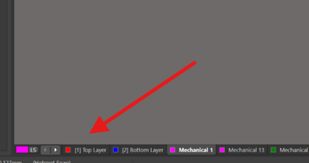
*Figura 6.17.1: Selección de la capa Top Layer.*

  

**2. Activar la herramienta Polygon Pour:**
En la barra de herramientas flotante superior, se localiza el ícono de vertido de polígono o se presiona el atajo `P > G` (Place Polygon Pour). En la ventana de propiedades que se despliega, se selecciona en el campo Net la red de tierra (GND) y se establece la forma de vertido. 

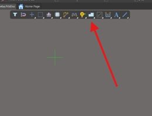
*Figura 6.17.2: Activación de la herramienta de vertido.*

  

**3. Delimitar la zona de vertido:**
Haciendo clics sucesivos alrededor del borde exterior del contorno magenta (Mechanical 1), se dibuja un área poligonal que envuelva toda la placa. 

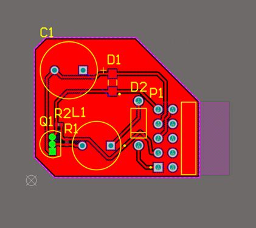
*Figura 6.17.3: Vertido trazado alrededor del contorno mecánico de la placa.*

  

---

## 6.18 Asignación de Red y Regeneración

Para vincular correctamente el plano de vertido de cobre a la red de masa y regenerarlo sobre el lienzo de la PCB, se realizan las siguientes acciones en el panel Properties:

**1. Asignar la red de conexión (Net -> GND):**
Al seleccionar el polígono dibujado, se despliega el panel Properties a la derecha de la pantalla. En la sección Properties, se ubica el campo `Net` y se despliega el menú para seleccionar la red `GND`. De esta forma, el vertido se conectará eléctricamente a todos los pads y terminales de tierra. 

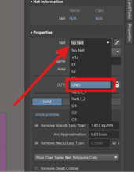
*Figura 6.18.1: Asignación de la red GND en el panel Properties.*

  

**2. Regenerar el plano de cobre (Repour):**
Si el polígono aún no ha sido vertido o sufrió modificaciones en sus propiedades, aparecerá un aviso azul en la parte superior del panel con la leyenda *"Polygon not poured"*. Se hace clic en el botón `Repour`. 

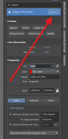
*Figura 6.18.2: Función Repour para recalcular la geometría.*

  

**Resultado final del vertido de masa:**
Altium recalcula la geometría del cobre inundando toda la cara superior en color rojo. Los pads pertenecientes a la red GND se integran automáticamente mediante conexiones térmicas en cruz (Thermal Reliefs), mientras que las pistas de otras señales (+12, E1, O1, etc.) quedan aisladas con un margen de separación (clearance) respetando las reglas de diseño, eliminando las líneas de conexión (ratsnest) sin necesidad de rutearlas manualmente.

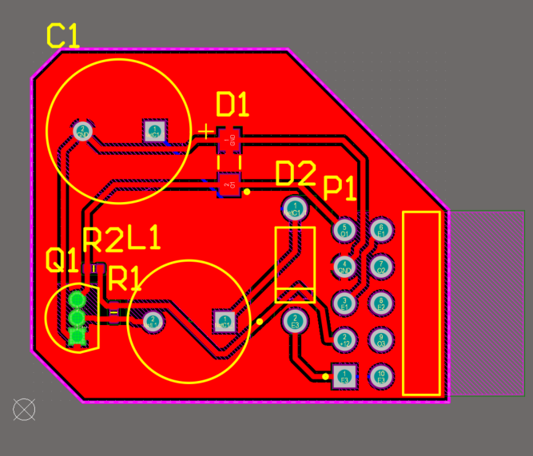
*Figura 6.18.3: Polígono de cobre completamente vertido y aislado.*

  

---

## 6.19 Vertido en Rejilla (Hatched)

La alternativa de vertido de cobre en forma de rejilla o malla (Hatched) es utilizada comúnmente para reducir el estrés térmico en la placa o para aplicaciones específicas de flexibilidad y radiofrecuencia. 

**1. Selección del estilo Hatched:**
En el panel Properties del polígono seleccionado, se cambia el modo de relleno de `Solid` a `Hatched`. 

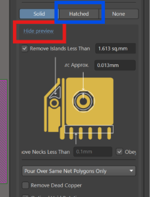
*Figura 6.19.1: Cambio de relleno de Solid a Hatched.*

  

**2. Ajuste de parámetros de la malla:**
En las opciones avanzadas del polígono, se ajustan el ancho de la pista (Track Width) y el espaciado de la rejilla (Grid Size). En la sección `Hatch mode`, se define la orientación del trazado de la malla, como `90 Degree` (perpendicular), `45 Degree` (diagonal), Horizontal o Vertical. 

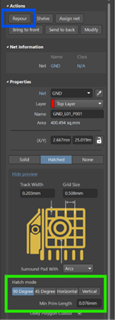
*Figura 6.19.2: Parámetros de grosor, espaciado y orientación de la rejilla.*

  

**3. Regenerar el polígono (Repour):**
Se presiona el botón `Repour` en la parte superior de las propiedades para recalcular la geometría del cobre. La zona de cobre sobre la capa roja deja de ser una capa sólida continua y pasa a mostrar un patrón en cuadrícula regular, manteniendo todas las interconexiones eléctricas a la red GND e integrando los relieves térmicos en los pads correspondientes.

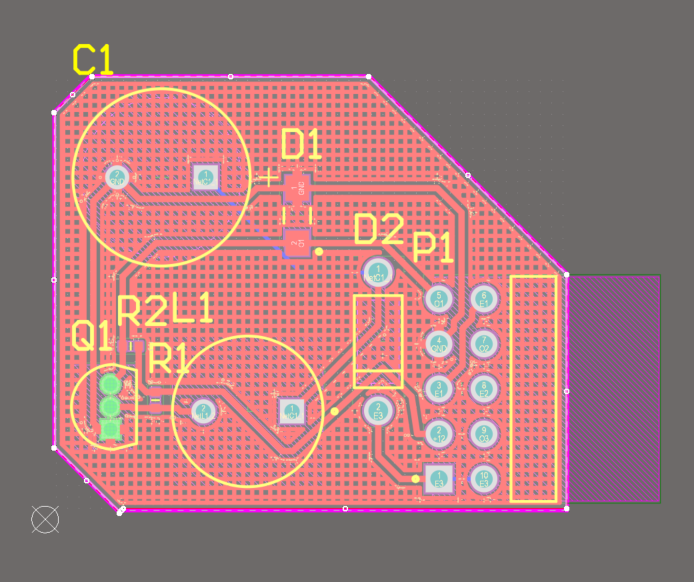
*Figura 6.19.3: Patrón de cobre en formato de malla integrado en la capa Top.*

  

---

## 6.20 Plano Inferior e Inspección Tridimensional Final

Para concluir el procedimiento de diseño, aplicamos el plano de vertido de cobre en la cara inferior y realizamos la inspección tridimensional de la tarjeta.

**1. Plano de masa en la capa inferior (Bottom Layer):**
En la barra inferior de capas, se selecciona la pestaña `[2] Bottom Layer` (color azul). Se utiliza nuevamente la herramienta Polygon Pour (P > G) asignando la red GND para crear un plano de masa en la cara inferior. En este caso se ilustra un vertido sólido. 

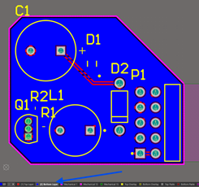
*Figura 6.20.1: Selección de la capa de ruteo inferior (Bottom Layer).*

  

**2. Inspección 3D cara superior (Top View):**
Al presionar la tecla `3`, se verifica la disposición final en la cara superior, donde destacan los componentes Through-Hole (electrolítico C1, inductor L1, transistor Q1, diodo D2 y conector P1) y los componentes de montaje superficial (SMD). 

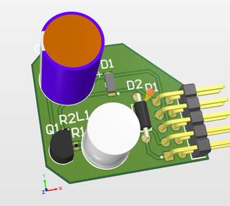
*Figura 6.20.2: Vista tridimensional final de la cara superior de la PCB.*

  

**3. Inspección 3D cara inferior (Bottom View):**
Rotando la vista 3D con `Shift + Clic derecho`, se inspecciona la cara inferior de la PCB. Se comprueba la proyección de los pines de soldadura Through-Hole, las pistas ruteadas en azul y el patrón de relieve del plano de cobre en la parte posterior. 

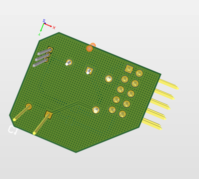
*Figura 6.20.3: Vista tridimensional final de la cara inferior.*

  

---

## 6.21 Ejecución del Chequeo Final de Reglas de Diseño (DRC)

Para ejecutar la verificación automática de reglas de diseño (DRC) sobre la placa terminada y evaluar el reporte de resultados, seguimos estos pasos:

**1. Acceso a la herramienta de verificación:**
En la barra de menús superior dentro de la PCB, se hace clic en la pestaña `Tools`. En el menú desplegable, se selecciona la primera opción: `Design Rule Check...`. 

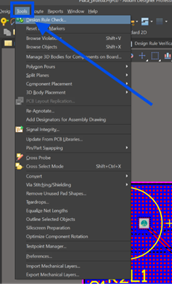
*Figura 6.21.1: Menú Tools > Design Rule Check.*

  

**2. Configuración y ejecución del reporte (Design Rule Checker):**
Se desplegará la ventana emergente Design Rule Checker. En este cuadro se pueden habilitar o deshabilitar las categorías de reglas a inspeccionar (Electrical, Routing, Manufacturing, Placement, etc.). Para procesar la verificación completa, se hace clic en el botón `Run Design Rule Check...` ubicado en la esquina inferior izquierda. 

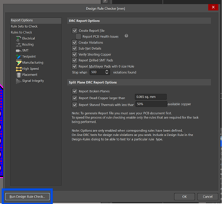
*Figura 6.21.2: Configuración del informe de reglas.*

  

**3. Análisis del informe (Design Rule Verification Report):**
Altium abrirá automáticamente una pestaña de reporte HTML con el resumen del análisis. El informe contabiliza las advertencias (Warnings) y las violaciones de reglas (Rule Violations). Un conteo mayor a cero en Rule Violations indica que existen infracciones físicas o eléctricas en la placa. Haciendo clic sobre el desglose de cada error dentro del reporte, Altium redirige automáticamente al punto exacto del lienzo de la PCB donde se encuentra la falla para corregirla.

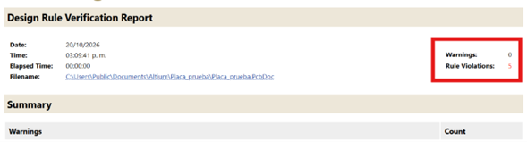
*Figura 6.21.3: Informe HTML con advertencias y violaciones detectadas.*

  

---

## 6.22 Etiquetas de Texto en Serigrafía (Top Overlay)

Para añadir texto personalizado o marcado de serigrafía (Silkscreen) sobre la tarjeta sin interferir con las pistas de cobre o los planos de masa:

**1. Seleccionar la capa de serigrafía (Top Overlay):**
En la barra inferior de capas de trabajo, se hace clic en la pestaña `Top Overlay` (de color amarillo). Esta capa está destinada exclusivamente a la impresión de tinta blanca sobre la placa (nombres de señales, logos y designadores). Al ser una capa aislante no conductora, no afecta ni altera las pistas de cobre.

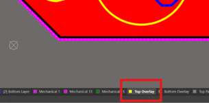
*Figura 6.22.1: Selección de la capa Top Overlay (Serigrafía).*

  

**2. Insertar texto interactivo:**
En la barra de herramientas flotante superior, se selecciona la herramienta de texto con el ícono `A` o se presiona el atajo `P > T` (Place String). Se hace clic en el área deseada de la tarjeta y, desde el panel Properties, se ingresa el texto personalizado.

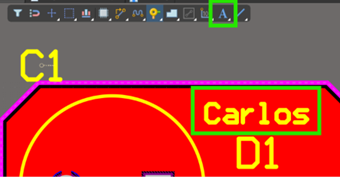
*Figura 6.22.2: Texto colocado en la cara superior.*

  

**3. Verificación tridimensional (3D View):**
Al conmutar a la vista fotorrealista presionado la tecla `3`, se confirma que el texto impreso aparece de color blanco sobre la máscara antisoldante verde. Se debe asegurar que el texto no quede ubicado directamente sobre zonas expuestas de soldadura.

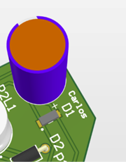
*Figura 6.22.3: Visualización de la tinta blanca en el modelo tridimensional.*

  

---

## 6.23 Serigrafía en la Cara Inferior (Bottom Overlay y Mirror)

**Selección de capa inferior y opción de espejo (Mirror):**
Al colocar una etiqueta de texto en la parte posterior de la placa, se selecciona la capa `Bottom Overlay`. Como se observa en el panel de propiedades, al trabajar en la capa inferior es estrictamente necesario marcar la casilla **Mirror**. 

*Razón técnica:* La vista 2D del software siempre es superior (se está "mirando a través" de la tarjeta). Al aplicar Mirror, el texto se invierte horizontalmente en el lienzo de diseño (mostrando el texto al revés), para que, cuando la PCB sea fabricada y se observe físicamente desde la cara posterior, las letras puedan leerse en la dirección correcta.

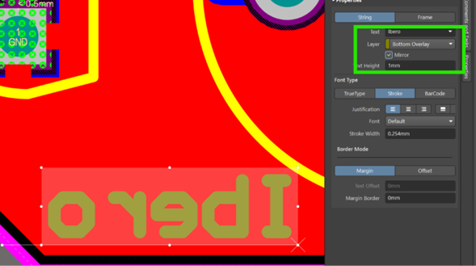
*Figura 6.23.1: Configuración de la propiedad Mirror para texto en la capa inferior.*

  

---

## 6.24 Salidas de Fabricación (Archivos Gerber)

El siguiente procedimiento permite exportar los archivos Gerber, los cuales contienen la información geométrica de cada capa requerida por los fabricantes de PCB. 

**1. Acceso al menú de generación de archivos Gerber:**
En la barra de menús superior, se hace clic en `File > Fabrication Outputs > Gerber Files`. 

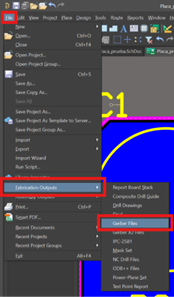
*Figura 6.24.1: Menú para la generación de archivos Gerber.*

  

**2. Configuración de capas a exportar (Gerber Setup):**
En la ventana emergente, se asegura que las unidades estén configuradas de acuerdo con la necesidad del fabricante. Para seleccionar únicamente las capas que contienen información utilizada en el diseño, se despliega el menú inferior `Plot Layers` y se elige `Select Used`. Para procesar la exportación, se presiona el botón Apply. 

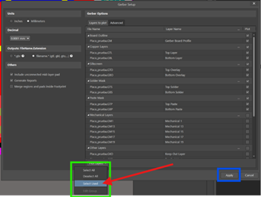
*Figura 6.24.2: Ventana de configuración Gerber Setup.*

  

**3. Generación y visualización del archivo CAMtastic:**
Altium abrirá automáticamente un visor interno de fotolitos en formato CAMtastic, donde se muestran las capas exportadas (como se aprecia con la capa inferior y la etiqueta reflejada en espejo). 

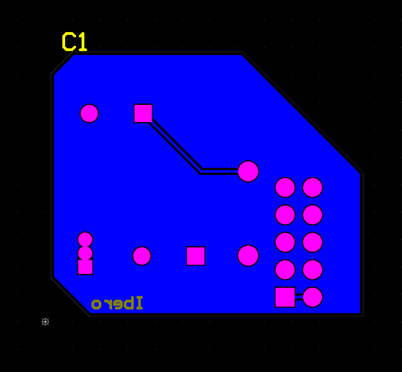
*Figura 6.24.3: Visor CAMtastic confirmando las capas generadas.*

  

**4. Ubicación de los archivos generados:**
Altium crea automáticamente la carpeta `Project Outputs for [Nombre_Proyecto]` dentro de la ubicación del proyecto. En esta carpeta se almacenan todos los archivos individuales con sus respectivas extensiones estándar (.GTL, .GBL, .GTO, .GBO, etc.).

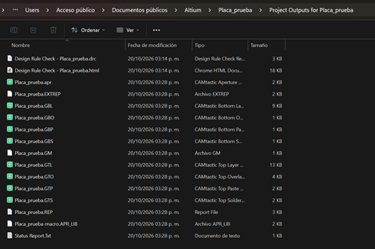
*Figura 6.24.4: Listado de archivos .GBR creados en el explorador de Windows.*

  

---

## 6.25 Archivos de Perforación (NC Drill)

Para completar el paquete de fabricación, resta generar el archivo de brocas y taladros:

**Generar perforaciones:**
Ir al menú `File > Fabrication Outputs > NC Drill Files`. En la ventana emergente de configuración, mantener las mismas unidades (métrica/imperial) e igual formato numérico que los archivos Gerber. Hacer clic en OK y confirmar el procesamiento en la ventana emergente de la lista de herramientas. 

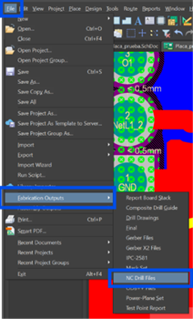
*Figura 6.25.1: Exportación de datos de brocas y perforaciones.*

  

**Archivos de salida:**
En la misma carpeta `Project Outputs` se agregarán los archivos con extensión `.txt` o `.drl` correspondiente a la tabla de barrenos y coordenadas de perforación. 

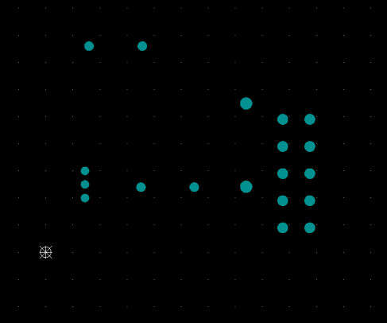
*Figura 6.25.2: Coordenadas mecánicas visualizadas como taladros en el visor.*

  

---

## 6.26 Empaquetado y Validación en JLCPCB

La etapa final del flujo de trabajo es el empaquetado de las salidas de fabricación y la carga en la plataforma del fabricante para su verificación y cotización.

**1. Compresión de los archivos de salida (Creación de archivo .ZIP):**
Se ubica la carpeta `Project Outputs` generada por Altium Designer. Se hace clic derecho sobre la carpeta y se selecciona la opción `Comprimir a... > Archivo ZIP` para crear el contenedor comprimido con los archivos Gerber y de perforación. 

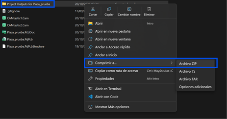
*Figura 6.26.1: Compresión de los ficheros de fabricación.*

  

**2. Carga en la plataforma de fabricación (Uploading Gerber):**
En el sitio web del fabricante (JLCPCB), se selecciona la herramienta de cotización en línea (Online PCB Quote) e importación de archivos. Se arrastra el archivo `.ZIP` recién creado; el sistema iniciará el procesamiento y la lectura automática del archivo. 

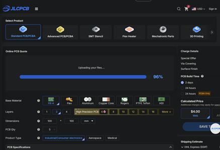
*Figura 6.26.2: Carga del archivo .zip en JLCPCB.*

  

**3. Inspección y verificación de cotización (Gerber Viewer):**
Una vez procesado el archivo, el visor integrado del fabricante renderiza la vista previa de la tarjeta por ambas caras. Se valida la lectura correcta del contorno, dimensiones y capas. Finalmente, se seleccionan los parámetros de fabricación deseados (cantidad de placas, grosor de PCB de 1.6mm, color de máscara, etc.) para proceder con la orden de producción.

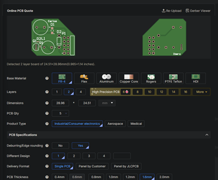
*Figura 6.26.3: Validación visual final y cotización del circuito en la plataforma web.*
