# 🤖 Proceso de Desarrollo de Proyecto: Siguelíneas

Bienvenido a la bitácora de desarrollo de nuestro robot siguelíneas. En esta sección documentaremos toda la investigación previa, la selección de componentes, el diseño del chasis y la lógica de control.

---
## Introducción

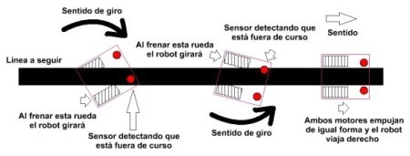
*Figura 1: Representación de la corrección de trayectoria en un robot siguelíneas.*

  

### 1. Introducción y Fundamentos del Robot Siguelíneas
Un robot siguelíneas (Line Follower Robot) es un sistema móvil autónomo diseñado para detectar y seguir de manera precisa una trayectoria definida sobre una pista de prueba. El principio de funcionamiento se basa en la lectura continua de contraste óptico mediante sensores reflectivos (como arreglos infrarrojos), permitiendo al sistema discernir entre la línea de guía y el fondo de la pista.

#### 1.1. Esquemas de Color y Configuración de Pista
En el ámbito de la robótica de competencia y desarrollo experimental, se consideran dos esquemas principales de contraste para el trazado de trayectorias:
*   **Fondo Negro con Línea Blanca:** Es la configuración más habitual en competencias de velocistas y siguelíneas profesionales (como pistas de prueba tipo JSumo). Requiere que el arreglo de sensores detecte una franja reflectiva blanca sobre un fondo opaco o mate absorbente de luz.
*   **Fondo Blanco con Línea Negra:** Empleado comúnmente en pruebas estandarizadas y entornos educativos, donde el sensor detecta la ausencia de reflexión infrarroja generada por la cinta o trazo negro sobre la superficie clara.

#### 1.2. Objetivo del Proyecto
El propósito central de este desarrollo es el diseño, integración electrónica y ruteado de una placa de circuito impreso (PCB) optimizada para un robot siguelíneas profesional. La implementación busca garantizar estabilidad eléctrica, minimización de ruido en las lecturas analógicas de los sensores, respuesta dinámica en la etapa de potencia para el control de motores y un empaquetado compacto que reduzca el peso total del chasis para optimizar la velocidad en pista.

---

## 2. Clasificación de Robots Siguelíneas según la Cinemática de Dirección

La arquitectura mecánica y el sistema de locomoción determinan la maniobrabilidad, velocidad máxima y complejidad del algoritmo de control del robot. Principalmente se dividen en dos categorías cinemáticas:

### 2.1. Dirección Diferencial (Differential Drive)
Es la configuración más extendida en robots velocistas y siguelíneas de alta velocidad debido a su baja inercia y simplicidad mecánica.
*   **Principio de Operación:** Se compone de dos ruedas motrices independientes montadas sobre un mismo eje transversal, asistidas por uno o dos puntos de apoyo pasivos (ruedas locas o apoyos deslizantes de PTFE/teflón).
*   **Mecanismo de Giro:** Los cambios de dirección se logran variando la velocidad relativa entre ambos motores (mediante modulación por ancho de pulso, PWM). Para giros cerrados, las ruedas pueden girar en sentidos opuestos, permitiendo un radio de giro nulo sobre su propio eje.
*   **Impacto en el Diseño Electrónico / PCB:** Requiere la integración de un controlador de motores doble (puente H como el TB6612FNG o drivers de MOSFETs discretos) capaz de manipular dos canales de potencia independientes.

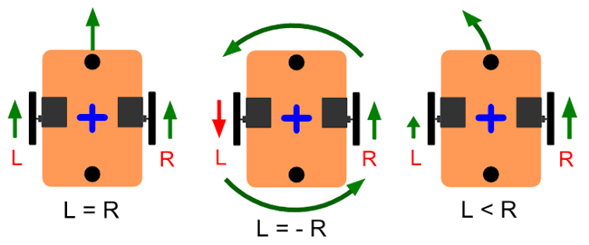
*Figura 2.1.1: Cinemática de dirección diferencial variando la velocidad de los motores.*

  

### 2.2. Dirección Mecánica o Direccionable (Ackermann / Servodirección)
Esta configuración replica la cinemática de los vehículos convencionales de cuatro ruedas.
*   **Principio de Operación:** Separa la función de tracción de la función de dirección. La tracción se ejerce sobre las ruedas traseras (o delanteras) mediante un motor principal, mientras que un mecanismo articulado (asistido por un servomotor) orienta el ángulo de las ruedas delanteras.
*   **Mecanismo de Giro:** Sigue la geometría de giro de Ackermann, restringiendo el radio mínimo de giro pero ofreciendo una trayectoria más fluida en curvas amplias a alta velocidad.
*   **Impacto en el Diseño Electrónico / PCB:** Exige salidas dedicadas para el control de servos de alta velocidad (PWM de precisión) y un canal de tracción de mayor potencia eléctrica para el motor principal.

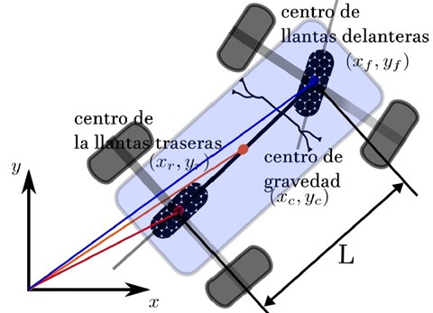
*Figura 2.2.1: Diagrama geométrico ilustrando el centro de gravedad y el ángulo de dirección de las llantas delanteras.*

  

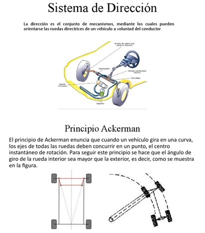
*Figura 2.2.2: Principio de Ackermann aplicado a sistemas de dirección mecánica.*

  

---

## 3. Criterios de Diseño e Ingeniería para Robots Siguelíneas de Alta Velocidad (Velocistas)

El desarrollo de un robot siguelíneas de grado de competencia no solo implica la correcta interconexión de sus componentes electrónicos, sino también el cumplimiento estricto de principios de diseño orientado al rendimiento dinámico. A continuación, se detallan los pilares fundamentales que rigen la optimización del sistema:

### 3.1. Optimización Estructural y Centro de Masa
El chasis del robot debe garantizar un equilibrio óptimo entre rigidez mecánica y baja inercia. 
*   **Estructura Rígida y Estable:** La flexión en el chasis introduce variaciones indeseadas en la distancia de lectura de los sensores de suelo. Por ello, la estructura debe ser rígida para absorber las vibraciones mecánicas generadas por los motores a altas RPM. 
*   **Centro de Masa Bajo:** Posicionar la batería, motores y componentes de mayor peso lo más cerca posible del plano de la pista reduce el momento de vuelco y evita derrapes en curvas de radio cerrado, maximizando el agarre (grip) de los neumáticos. 

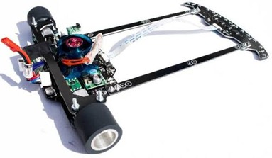
*Figura 3.1.1: Diseño estructural de bajo centro de gravedad.*

  

### 3.2. Reducción de Masa (Criterio de Ligereza)
En sistemas dinámicos de alta aceleración, la masa es el factor crítico que limita la respuesta del robot (según la segunda ley de Newton, $F = m \cdot a$).
*   **Optimización de Peso:** Cada gramo adicional incrementa el consumo de corriente de los motores y reduce el par disponible para acelerar o frenar. 
*   **Impacto en el Diseño de la PCB:** La placa de circuito impreso suele cumplir una doble función: actuar como tarjeta electrónica y como propio chasis estructural (placa base). Se deben seleccionar espesores de PCB adecuados (por ejemplo, 1.0 mm o 1.6 mm) y optimizar el área de cobre para no añadir masa innecesaria. 

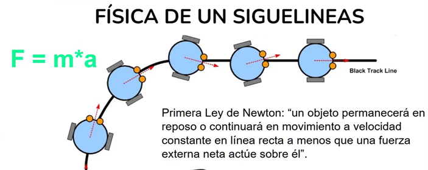
*Figura 3.2.1: Principios físicos aplicados a la reducción de masa.*

  

### 3.3. Control Dinámico: Gestión de Curvas y Frenado
El rendimiento en pista no se mide únicamente por la velocidad máxima en tramos rectos, sino por la eficiencia en la transición hacia tramos sinuosos. 
*   **Control de Velocidad:** El algoritmo de control (usualmente un bucle PID) debe implementar esquemas de aceleración progresiva y desaceleración o frenado activo (frenado dinámico por puente H) antes de ingresar a una curva. 
*   **Recuperación Rápida:** Minimizar el tiempo de asentamiento del sistema tras salir de una perturbación o curva para retomar la velocidad máxima de manera inmediata. 

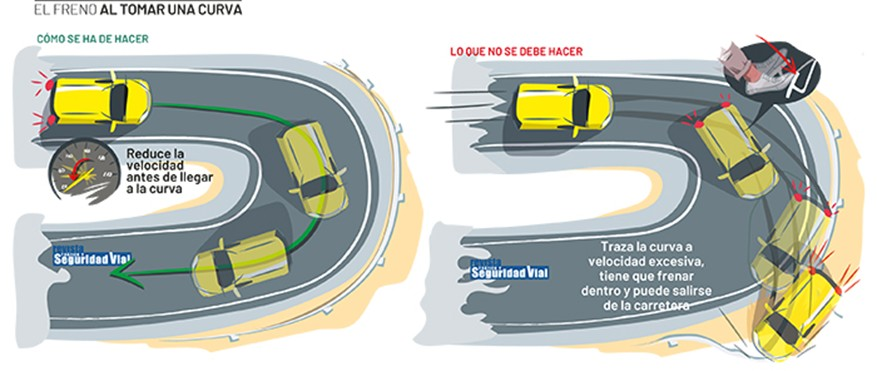
*Figura 3.3.1: Comportamiento dinámico en curvas cerradas.*

  

### 3.4. Proceso Iterativo de Calibración y Ajuste
El desarrollo de un siguelíneas profesional requiere una metodología experimental basada en pruebas sistemáticas: 
*   **Medición:** Adquisición de datos en tiempo real (telemetría de sensores, velocidad de motores y tiempos de vuelta). 
*   **Ajuste:** Ajuste fino de constantes del controlador (PID), umbrales de lectura en los sensores y perfiles de voltaje. 
*   **Validación:** Pruebas repetitivas en pista para asegurar la repetibilidad y estabilidad del vehículo ante cambios de iluminación o textura del suelo.

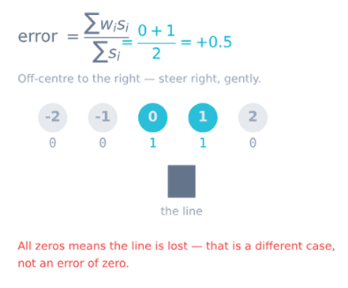
*Figura 3.4.1: Cálculo y evaluación de errores en el arreglo de sensores.*

  

---

## 4. Arquitectura de Hardware y Partes Principales del Robot

La integración electrónica y mecánica de un robot siguelíneas profesional requiere la selección coordinada de subsistemas clave. A continuación, se describen los componentes estructurales, de control, potencia y percepción que conforman la plataforma: 

### 4.1. Unidad de Procesamiento (Microcontrolador)
*   **Componente:** Arduino Nano (o equivalente en tarjeta base). 
*   **Función:** Actúa como la unidad central de procesamiento (cerebro del robot). Se encarga de ejecutar el bucle de control en tiempo real, muestrear las señales provenientes de la barra de sensores, calcular el error de trayectoria mediante algoritmos de control (por ejemplo, PID) y enviar las señales de modulación por ancho de pulso (PWM) a la etapa de potencia. 

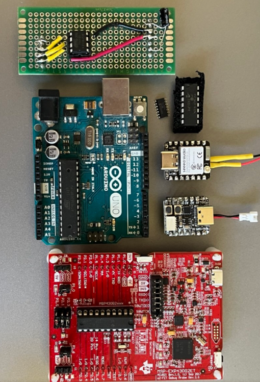
*Figura 4.1.1: Opciones de microcontroladores para procesamiento lógico.*

  

### 4.2. Arreglo de Percepción (Barra de Sensores)
*   **Componente:** Arreglo frontal de sensores reflectivos infrarrojos. 
*   **Función:** Detecta la posición relativa del vehículo con respecto a la línea de guía de la pista mediante la lectura del contraste infrarrojo entre la superficie reflectiva y el fondo. El diseño extendido de la barra sobre el eje frontal permite anticipar las curvas y calcular el vector de error con mayor resolución espacial. 

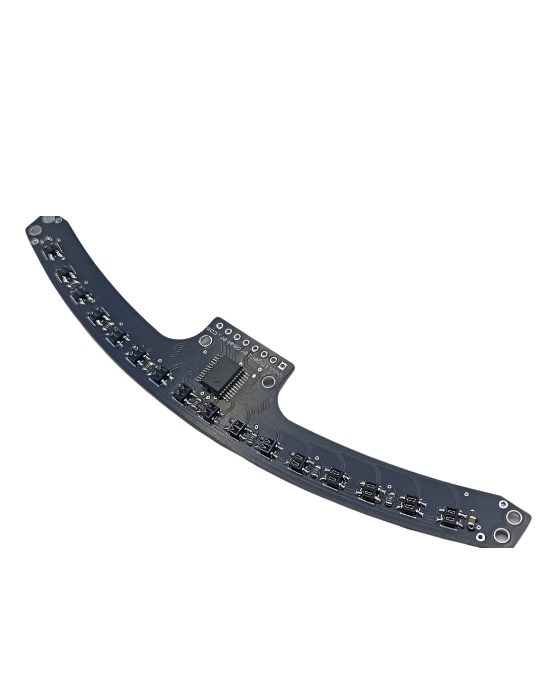
*Figura 4.2.1: Arreglo curvo de sensores QTR para percepción de línea.*

  

### 4.3. Etapa de Potencia y Control de Motores
*   **Componente:** Controlador de motores Dual (Puente H TB6612FNG). 
*   **Función:** Administra el flujo de corriente entregado a los actuadores desde la fuente de alimentación principal. Permite conmutar la dirección de giro y regular la velocidad de cada motor mediante señales PWM enviadas por el microcontrolador, garantizando una respuesta dinámica rápida y protección contra picos de corriente inductiva. 

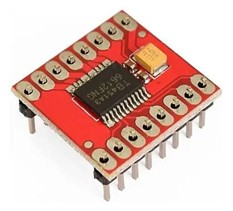
*Figura 4.3.1: Driver de motores puente H.*

  

### 4.4. Sistema de Actuación Mecánica
*   **Componentes:** Micromotores de DC tipo N20 acoplados a llantas de alta tracción. 
*   **Función:** Los motores N20 con caja reductora integrada transforman la energía eléctrica en par mecánico para desplazar el robot. Las ruedas (con neumáticos de hule o silicona de alto agarre) garantizan la transferencia eficiente de torque hacia la pista, minimizando el deslizamiento lateral en giros a alta velocidad. 

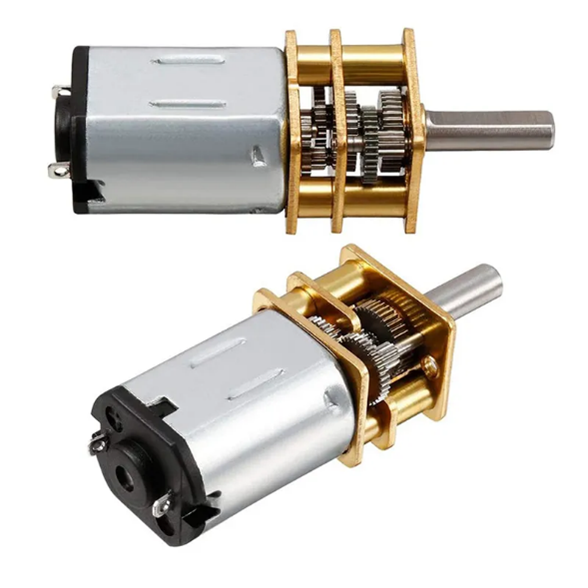
*Figura 4.4.1: Micromotores DC N20 con caja reductora metálica.*

  

### 4.5. Sistema de Alimentación
*   **Componente:** Batería de Polímero de Litio (LiPo). 
*   **Función:** Suministra la energía eléctrica necesaria para todo el sistema, proporcionando una alta tasa de descarga constante necesaria para el frenado y aceleración de los motores. 

*Figura 4.5.1: Batería LiPo de alta tasa de descarga.*

  

### 4.6. Chasis Estructural e Interfaz de Usuario
*   **Componentes:** Chasis integrado (PCB como base mecánica) y pantalla OLED (0.91" 128x32) o turbina EDF. 
*   **Función:** El chasis soporta y distribuye mecánicamente cada elemento sobre el plano. La pantalla OLED desplegada sobre la placa facilita la depuración en campo, mostrando estados de calibración, lecturas de sensores y voltaje de la batería sin requerir una conexión cableada a la computadora. Adicionalmente, el uso de turbinas genera fuerza descendente (downforce) para un mayor agarre.

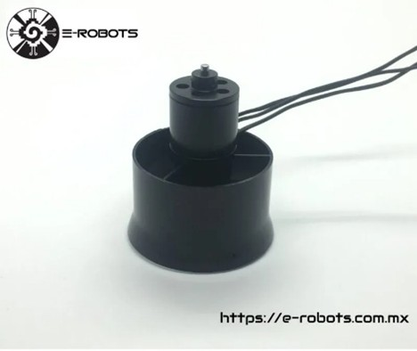
*Figura 4.6.1: Turbina de succión (EDF) para downforce.*

  

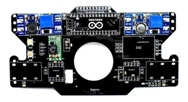
*Figura 4.6.2: Placa de circuito impreso fungiendo estructuralmente como chasis del robot.*
