# Proceso de Desarrollo de Proyecto: Siguelíneas

Bienvenido a la bitácora de desarrollo de nuestro robot siguelíneas. En esta sección documentaremos toda la investigación previa, la selección de componentes, el diseño del chasis y la lógica de control.

---

## Introducción

*Figura 1: Representación de la corrección de trayectoria en un robot siguelíneas.*

  

### 1. Introducción y Fundamentos del Robot Siguelíneas
Un robot siguelíneas (Line Follower Robot) es un sistema móvil autónomo diseñado para detectar y seguir de manera precisa una trayectoria definida sobre una pista de prueba. El principio de funcionamiento se basa en la lectura continua de contraste óptico mediante sensores reflectivos (como arreglos infrarrojos), permitiendo al sistema discernir entre la línea de guía y el fondo de la pista.

#### 1.1. Esquemas de Color y Configuración de Pista
En el ámbito de la robótica de competencia y desarrollo experimental, se consideran dos esquemas principales de contraste para el trazado de trayectorias:
*   **Fondo Negro con Línea Blanca:** Es la configuración más habitual en competencias de velocistas y siguelíneas profesionales (como pistas de prueba tipo JSumo). Requiere que el arreglo de sensores detecte una franja reflectiva blanca sobre un fondo opaco o mate absorbente de luz.
*   **Fondo Blanco con Línea Negra:** Empleado comúnmente en pruebas estandarizadas y entornos educativos, donde el sensor detecta la ausencia de reflexión infrarroja generada por la cinta o trazo negro sobre la superficie clara.

#### 1.2. Objetivo del Proyecto
El propósito central de este desarrollo es el diseño, integración electrónica y ruteado de una placa de circuito impreso (PCB) optimizada para un robot siguelíneas profesional. La implementación busca garantizar estabilidad eléctrica, minimización de ruido en las lecturas analógicas de los sensores, respuesta dinámica en la etapa de potencia para el control de motores y un empaquetado compacto que reduzca el peso total del chasis para optimizar la velocidad en pista.

---

## 2. Clasificación de Robots Siguelíneas según la Cinemática de Dirección

La arquitectura mecánica y el sistema de locomoción determinan la maniobrabilidad, velocidad máxima y complejidad del algoritmo de control del robot. Principalmente se dividen en dos categorías cinemáticas:

### 2.1. Dirección Diferencial (Differential Drive)
Es la configuración más extendida en robots velocistas y siguelíneas de alta velocidad debido a su baja inercia y simplicidad mecánica.
*   **Principio de Operación:** Se compone de dos ruedas motrices independientes montadas sobre un mismo eje transversal, asistidas por uno o dos puntos de apoyo pasivos (ruedas locas o apoyos deslizantes de PTFE/teflón).
*   **Mecanismo de Giro:** Los cambios de dirección se logran variando la velocidad relativa entre ambos motores (mediante modulación por ancho de pulso, PWM). Para giros cerrados, las ruedas pueden girar en sentidos opuestos, permitiendo un radio de giro nulo sobre su propio eje.
*   **Impacto en el Diseño Electrónico / PCB:** Requiere la integración de un controlador de motores doble (puente H como el TB6612FNG o drivers de MOSFETs discretos) capaz de manipular dos canales de potencia independientes.

*Figura 2.1.1: Cinemática de dirección diferencial variando la velocidad de los motores.*

  

### 2.2. Dirección Mecánica o Direccionable (Ackermann / Servodirección)
Esta configuración replica la cinemática de los vehículos convencionales de cuatro ruedas.
*   **Principio de Operación:** Separa la función de tracción de la función de dirección. La tracción se ejerce sobre las ruedas traseras (o delanteras) mediante un motor principal, mientras que un mecanismo articulado (asistido por un servomotor) orienta el ángulo de las ruedas delanteras.
*   **Mecanismo de Giro:** Sigue la geometría de giro de Ackermann, restringiendo el radio mínimo de giro pero ofreciendo una trayectoria más fluida en curvas amplias a alta velocidad.
*   **Impacto en el Diseño Electrónico / PCB:** Exige salidas dedicadas para el control de servos de alta velocidad (PWM de precisión) y un canal de tracción de mayor potencia eléctrica para el motor principal.

*Figura 2.2.1: Diagrama geométrico ilustrando el centro de gravedad y el ángulo de dirección de las llantas delanteras.*

  

*Figura 2.2.2: Principio de Ackermann aplicado a sistemas de dirección mecánica.*

  

---

## 3. Criterios de Diseño e Ingeniería para Robots Siguelíneas de Alta Velocidad (Velocistas)

El desarrollo de un robot siguelíneas de grado de competencia no solo implica la correcta interconexión de sus componentes electrónicos, sino también el cumplimiento estricto de principios de diseño orientado al rendimiento dinámico. A continuación, se detallan los pilares fundamentales que rigen la optimización del sistema:

### 3.1. Optimización Estructural y Centro de Masa
El chasis del robot debe garantizar un equilibrio óptimo entre rigidez mecánica y baja inercia. 
*   **Estructura Rígida y Estable:** La flexión en el chasis introduce variaciones indeseadas en la distancia de lectura de los sensores de suelo. Por ello, la estructura debe ser rígida para absorber las vibraciones mecánicas generadas por los motores a altas RPM. 
*   **Centro de Masa Bajo:** Posicionar la batería, motores y componentes de mayor peso lo más cerca posible del plano de la pista reduce el momento de vuelco y evita derrapes en curvas de radio cerrado, maximizando el agarre (grip) de los neumáticos. 

*Figura 3.1.1: Diseño estructural de bajo centro de gravedad.*

  

### 3.2. Reducción de Masa (Criterio de Ligereza)
En sistemas dinámicos de alta aceleración, la masa es el factor crítico que limita la respuesta del robot (según la segunda ley de Newton, $F = m \cdot a$).
*   **Optimización de Peso:** Cada gramo adicional incrementa el consumo de corriente de los motores y reduce el par disponible para acelerar o frenar. 
*   **Impacto en el Diseño de la PCB:** La placa de circuito impreso suele cumplir una doble función: actuar como tarjeta electrónica y como propio chasis estructural (placa base). Se deben seleccionar espesores de PCB adecuados (por ejemplo, 1.0 mm o 1.6 mm) y optimizar el área de cobre para no añadir masa innecesaria. 

*Figura 3.2.1: Principios físicos aplicados a la reducción de masa.*

  

### 3.3. Control Dinámico: Gestión de Curvas y Frenado
El rendimiento en pista no se mide únicamente por la velocidad máxima en tramos rectos, sino por la eficiencia en la transición hacia tramos sinuosos. 
*   **Control de Velocidad:** El algoritmo de control (usualmente un bucle PID) debe implementar esquemas de aceleración progresiva y desaceleración o frenado activo (frenado dinámico por puente H) antes de ingresar a una curva. 
*   **Recuperación Rápida:** Minimizar el tiempo de asentamiento del sistema tras salir de una perturbación o curva para retomar la velocidad máxima de manera inmediata. 

*Figura 3.3.1: Comportamiento dinámico en curvas cerradas.*

  

### 3.4. Proceso Iterativo de Calibración y Ajuste
El desarrollo de un siguelíneas profesional requiere una metodología experimental basada en pruebas sistemáticas: 
*   **Medición:** Adquisición de datos en tiempo real (telemetría de sensores, velocidad de motores y tiempos de vuelta). 
*   **Ajuste:** Ajuste fino de constantes del controlador (PID), umbrales de lectura en los sensores y perfiles de voltaje. 
*   **Validación:** Pruebas repetitivas en pista para asegurar la repetibilidad y estabilidad del vehículo ante cambios de iluminación o textura del suelo.

*Figura 3.4.1: Cálculo y evaluación de errores en el arreglo de sensores.*

  

---

## 4. Arquitectura de Hardware y Partes Principales del Robot

La integración electrónica y mecánica de un robot siguelíneas profesional requiere la selección coordinada de subsistemas clave. A continuación, se describen los componentes estructurales, de control, potencia y percepción que conforman la plataforma: 

### 4.1. Unidad de Procesamiento (Microcontrolador)
*   **Componente:** Arduino Nano (o equivalente en tarjeta base). 
*   **Función:** Actúa como la unidad central de procesamiento (cerebro del robot). Se encarga de ejecutar el bucle de control en tiempo real, muestrear las señales provenientes de la barra de sensores, calcular el error de trayectoria mediante algoritmos de control (por ejemplo, PID) y enviar las señales de modulación por ancho de pulso (PWM) a la etapa de potencia. 

*Figura 4.1.1: Opciones de microcontroladores para procesamiento lógico.*

  

### 4.2. Arreglo de Percepción (Barra de Sensores)
*   **Componente:** Arreglo frontal de sensores reflectivos infrarrojos. 
*   **Función:** Detecta la posición relativa del vehículo con respecto a la línea de guía de la pista mediante la lectura del contraste infrarrojo entre la superficie reflectiva y el fondo. El diseño extendido de la barra sobre el eje frontal permite anticipar las curvas y calcular el vector de error con mayor resolución espacial. 

*Figura 4.2.1: Arreglo curvo de sensores QTR para percepción de línea.*

  

### 4.3. Etapa de Potencia y Control de Motores
*   **Componente:** Controlador de motores Dual (Puente H TB6612FNG). 
*   **Función:** Administra el flujo de corriente entregado a los actuadores desde la fuente de alimentación principal. Permite conmutar la dirección de giro y regular la velocidad de cada motor mediante señales PWM enviadas por el microcontrolador, garantizando una respuesta dinámica rápida y protección contra picos de corriente inductiva. 

*Figura 4.3.1: Driver de motores puente H.*

  

### 4.4. Sistema de Actuación Mecánica
*   **Componentes:** Micromotores de DC tipo N20 acoplados a llantas de alta tracción. 
*   **Función:** Los motores N20 con caja reductora integrada transforman la energía eléctrica en par mecánico para desplazar el robot. Las ruedas (con neumáticos de hule o silicona de alto agarre) garantizan la transferencia eficiente de torque hacia la pista, minimizando el deslizamiento lateral en giros a alta velocidad. 

*Figura 4.4.1: Micromotores DC N20 con caja reductora metálica.*

  

### 4.5. Sistema de Alimentación
*   **Componente:** Batería de Polímero de Litio (LiPo). 
*   **Función:** Suministra la energía eléctrica necesaria para todo el sistema, proporcionando una alta tasa de descarga constante necesaria para el frenado y aceleración de los motores. 

*Figura 4.5.1: Batería LiPo de alta tasa de descarga.*

  

### 4.6. Chasis Estructural e Interfaz de Usuario
*   **Componentes:** Chasis integrado (PCB como base mecánica) y pantalla OLED (0.91" 128x32) o turbina EDF. 
*   **Función:** El chasis soporta y distribuye mecánicamente cada elemento sobre el plano. La pantalla OLED desplegada sobre la placa facilita la depuración en campo, mostrando estados de calibración, lecturas de sensores y voltaje de la batería sin requerir una conexión cableada a la computadora. Adicionalmente, el uso de turbinas genera fuerza descendente (downforce) para un mayor agarre.

*Figura 4.6.1: Turbina de succión (EDF) para downforce.*

  

*Figura 4.6.2: Placa de circuito impreso fungiendo estructuralmente como chasis del robot.*

## 5. Selección de Materiales y Componentes

### 5.1. Unidad de Procesamiento Principal (MCU): ESP32-C6 Super Mini
Para el desarrollo del robot siguelíneas de alta velocidad se seleccionó el módulo ESP32-C6 Super Mini (MakerGO). Esta plataforma de arquitectura RISC-V de 32 bits combina un factor de forma ultra compacto con un elevado rendimiento de procesamiento.

**Justificación Técnica de la Elección:**

| Característica | Detalle Técnico y Ventaja |
| :--- | :--- |
| **Arquitectura** | Procesador RISC-V de un núcleo a 160 MHz. Supera a plataformas de 8 bits (como el ATmega328P), reduciendo drásticamente el tiempo de cálculo del bucle de control. |
| **Factor de Forma** | Peso inferior a 3 gramos; su empaquetado permite soldarlo directamente como módulo de tarjeta hija (*breakout*) para ahorrar espacio y masa total. |
| **Periféricos (I/O)** | ADC de 12 bits para lectura de sensores, I2C/SPI para la pantalla OLED, y PWM de alta resolución para el control fino del puente H. |
| **Conectividad** | Wi-Fi 6 y Bluetooth 5 integrados, lo que permite implementar telemetría y calibración remota sin añadir el peso extra de módulos externos de radio. |
| **Alimentación** | Nivel lógico de 3.3V con regulador LDO en placa, alimentable directamente desde el pin de 5V. |

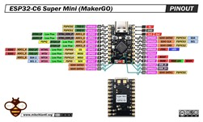{ width="800" }
*Figura 5.1.1: Diagrama de pines (Pinout) del módulo ESP32-C6 Super Mini.*

  

---

### 5.2. Sistema de Percepción: Barra de 16 Sensores Infrarrojos Multiplexados
Para garantizar una alta precisión en la detección del vector de error sobre la pista, se implementará una barra frontal de 16 sensores reflectivos.

#### 5.2.1. Principio Optoelectrónico de Detección
El funcionamiento se basa en pares emisor-receptor de luz infrarroja. El LED emisor transmite luz infrarroja hacia la pista; si la superficie es clara (sin obstáculo), refleja un alto porcentaje de radiación hacia el fototransistor receptor, provocando su conducción y variando su tensión de salida. Si la superficie es oscura, absorbe la luz y mantiene la tensión cercana al valor de reposo.

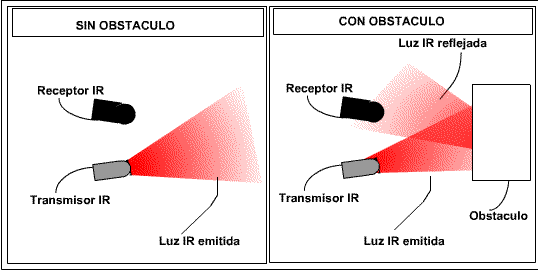
*Figura 5.2.1: Dinámica de reflexión infrarroja sobre superficies.*

  

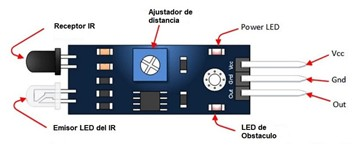
*Figura 5.2.2: Elementos de un módulo sensor infrarrojo estándar.*

  

#### 5.2.2. Selección del Sensor: QRE1113 (SMD)
Frente a módulos comerciales voluminosos basados en sensores tipo TCRT5000, se seleccionó el fototransistor reflectivo QRE1113GR en formato de montaje superficial (SMD). Su tamaño reducido permite una alta densidad de integración, disminuyendo la distancia entre sensores para mejorar la resolución espacial de la lectura. Además, su respuesta analógica permite cuantificar zonas grises o bordes de línea para utilizarlos en algoritmos de interpolación.

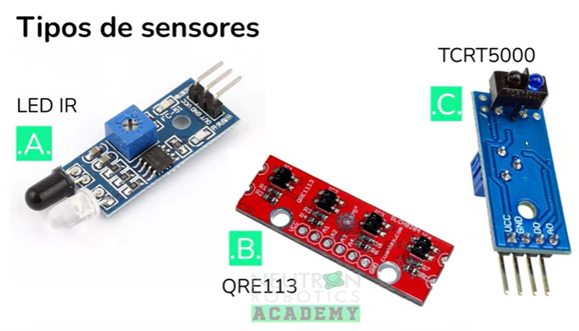
*Figura 5.2.3: Comparativa visual entre sensores IR estándar y el encapsulado QRE1113.*

  

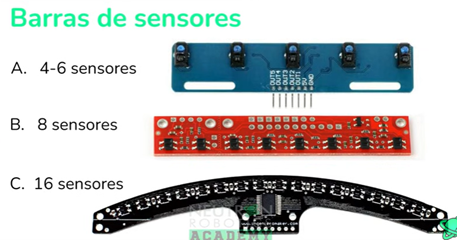
*Figura 5.2.4: Evolución en la densidad de integración en barras de sensores.*

  

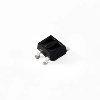
*Figura 5.2.5: Empaquetado SMD del fototransistor reflectivo QRE1113GR.*

  

#### 5.2.3. Esquema de Multiplexación Analógica (CD74HC4067)
Leer 16 canales analógicos de forma directa saturaría los pines del microcontrolador. Por ello, se integra un multiplexor analógico 74HC4067, el cual reduce las 16 salidas a un único pin analógico conectado al ESP32-C6. Utiliza solo 4 pines digitales (S0 a S3) para seleccionar el canal y opera a frecuencias elevadas para muestrear toda la barra en fracciones de milisegundo.

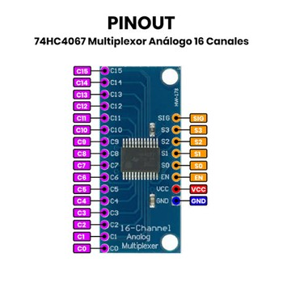
*Figura 5.2.6: Módulo multiplexor analógico de 16 canales 74HC4067.*

  

#### 5.2.4. Topología del Circuito Electrónico
A nivel de esquemático, cada LED infrarrojo se alimenta a 5V polarizado por una resistencia en serie de 330 Ω. La red receptora utiliza resistencias de carga de 4.7 kΩ conectadas a VCC; este nodo genera la señal analógica individual (Q0 a Q15) dirigida al multiplexor. Se incluye también un capacitor de desacoplo de 0.1 µF para estabilizar las lecturas y suprimir el ruido electromagnético.

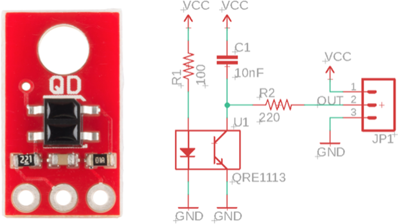
*Figura 5.2.7: Circuito base de acondicionamiento analógico para el QRE1113.*

  

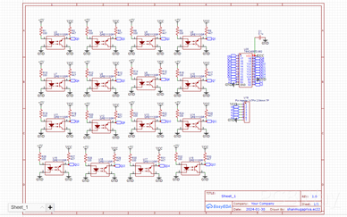
*Figura 5.2.8: Diseño integrando los 16 sensores reflectivos hacia el IC multiplexor.*

### 5.3. Actuadores de Tracción: Comparativa Tecnológica y Evolución de Motores
La selección de los motores para un robot velocista determina directamente la aceleración, velocidad máxima y capacidad de frenado del vehículo. A continuación, se analiza la clasificación general de motores de corriente directa (DC) y la evolución de los estándares empleados en competencia: 

#### 5.3.1. Clasificación Tecnológica de Motores de DC

**Motores con Escobillas (Brushed DC):**
*   **Características:** Constituyen la solución clásica y más accesible. Se componen de un rotor bobinado con colector de delgas y escobillas físicas para conmutar la corriente. 
*   **Ventajas:** Son económicos, de fácil adquisición y sencillos de controlar mediante etapas de potencia estándar (puentes H convencionales). 
*   **Desventajas:** La fricción mecánica de las escobillas limita su vida útil, genera ruido eléctrico y disminuye la eficiencia energética global. 

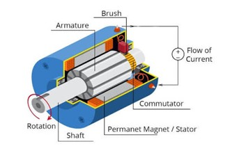
*Figura 5.3.1: Estructura interna de un motor DC clásico con escobillas.*

  

**Motores sin Escobillas (Brushless DC / BLDC):**
*   **Características:** Reemplazan la conmutación mecánica por una conmutación electrónica trifásica en el estator, con un rotor de imanes permanentes. 
*   **Ventajas:** Ofrecen la mayor eficiencia energética, elevada densidad de potencia y soportan un número de RPM extremadamente alto sin desgaste mecánico por escobillas. 
*   **Desventajas:** Exigen controladores electrónicos de velocidad dedicados (ESC) de mayor costo y complejidad de integración. Además, la inversión rápida del sentido de giro (frenado activo/reversa) resulta compleja y lenta en comparación con los esquemas de DC convencionales. 

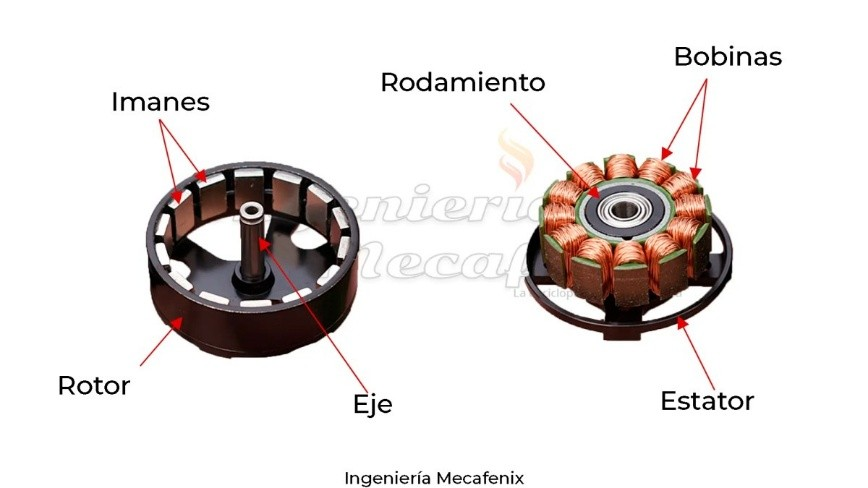
*Figura 5.3.2: Estator de bobinas y rotor de imanes permanentes en un motor BLDC.*

  

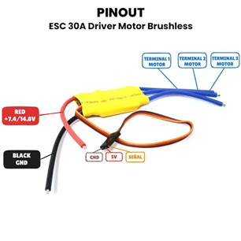
*Figura 5.3.3: Controlador electrónico de velocidad (ESC) necesario para motores BLDC.*

  

**Motores sin Núcleo (Coreless DC):**
*   **Características:** Eliminan el núcleo de hierro dulce en el rotor, utilizando un devanado cilíndrico auto-soportado que gira alrededor de un imán central de alta densidad magnética. 
*   **Ventajas:** Su inercia rotacional es prácticamente nula, lo que les otorga una respuesta dinámica y tasas de aceleración/frenado comparables a las de un motor brushless, manteniendo la simplicidad de control de un motor de escobillas tradicional mediante puente H. Alcanzan un régimen de RPM muy elevado. 
*   **Desventajas:** Entregan un par motor (torque) nominal bajo en su eje directo, por lo que requieren indefectiblemente el acople de una caja reductora de engranajes (gearbox) para elevar el torque utilizable a las ruedas. 

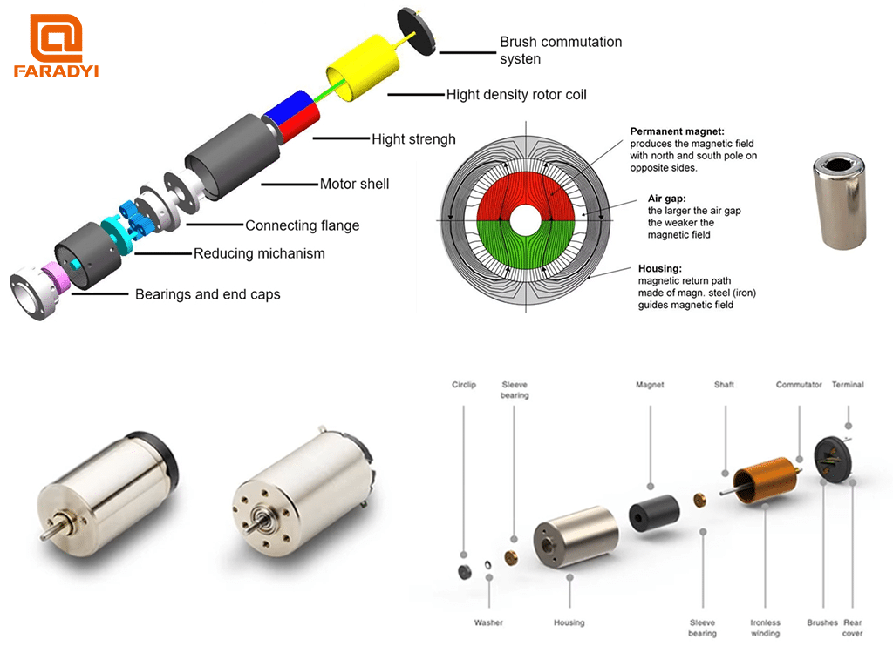{ width="800" }
*Figura 5.3.4: Despiece interno de un motor Coreless mostrando su devanado cilíndrico libre.*

  

---

#### 5.3.2. Evolución Histórica y Tendencias en la Robótica de Competencia

**Etapa Inicial – Micromotores N20 (Estándar Pololu):**
Inicialmente, los micromotores N20 con caja de engranajes metálica recta integrados (popularizados por Pololu) fueron la opción predominante debido a su extrema conveniencia física, incluyendo un eje en "D" estandarizado para el montaje directo de llantas. 
*   **Limitación:** Su formato ultra compacto limita el tamaño del bobinado, resultando en un torque insuficiente y una disipación térmica deficiente bajo regímenes de exigencia severa en pista. 

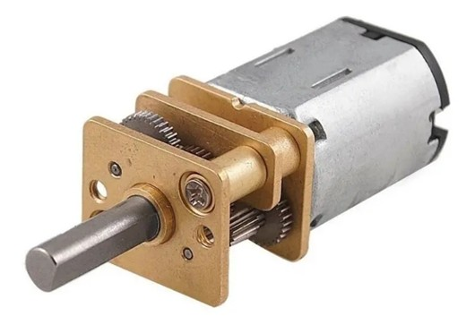
*Figura 5.3.5: Micromotor N20 clásico con caja reductora de piñones metálicos.*

  

**Etapa de Consolidación – Motores 180 Coreless con Caja Mabuchi:**
Posteriormente, la categoría adoptó de forma masiva los motores de formato 180 con tecnología coreless acoplados a reductoras tipo Mabuchi, posicionándose en el pico de uso por cerca del 90% de los competidores internacionales. 
*   **Ventajas:** Ofrecen un equilibrio superior entre par de salida y velocidad final, garantizando tracción constante en curvas exigentes. 

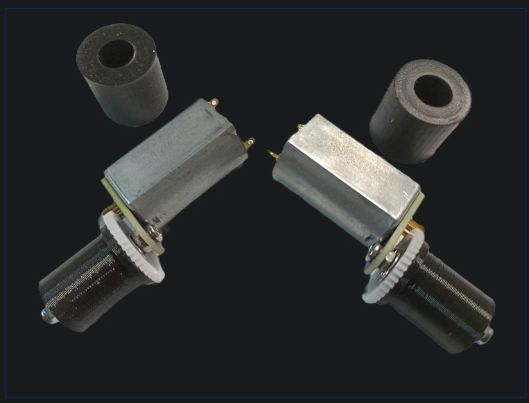{ width="800" }
*Figura 5.3.6: Ensambles de motores 180 Coreless adaptados con reductores.*

  

**Innovación Reciente – Motores N60 Coreless:**
En años recientes, desarrollos liderados por equipos de alto rendimiento (como Space Invaders Robotics) popularizaron el uso de motores N60 Coreless. 
*   **Ventajas Competitivas:** A pesar de ser más ligeros y compactos que los motores de tamaño 180, los motores N60 entregaron una densidad de potencia superior, superando los parámetros de torque, RPM y respuesta dinámica sin comprometer la ligereza del chasis ni alterar el centro de masa del vehículo.

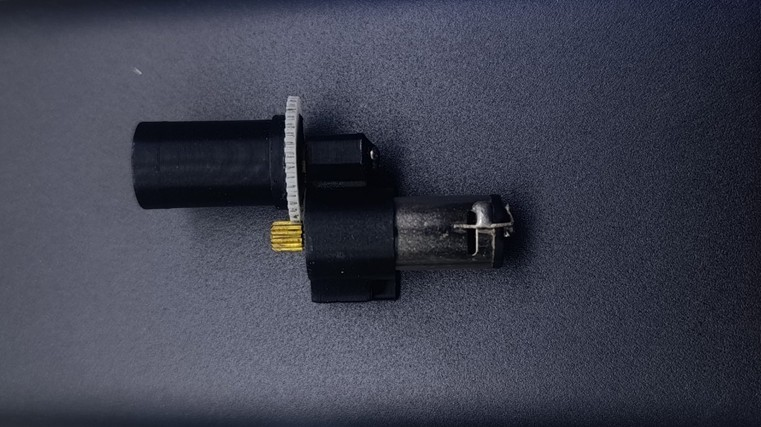
*Figura 5.3.7: Integración compacta del motor N60 Coreless con llanta adherente de silicón.*

---

### 5.4. Etapa de Potencia: Transición del Driver Estándar al Controlador BTN9960
El diseño de la etapa de potencia debe garantizar la entrega fluida de corriente hacia los actuadores principales sin sufrir caídas de tensión ni sobrecalentamientos durante los cambios bruscos de dirección o frenados dinámicos.

#### 5.4.1. Limitaciones del Driver Estándar (TB6612FNG)
El módulo TB6612FNG es el controlador dual de tipo Puente H más extendido en robótica móvil debido a su empaquetado reducido y facilidad de interfaz PWM. 
*   **Capacidad de Corriente:** Soporta hasta 1.2 A continuos (3.2 A pico) por canal. 
*   **Cuello de Botella:** Aunque es adecuado para motores N20 o prototipos de baja velocidad, resulta insuficiente para motores de alto rendimiento (como los N60 Coreless o 180 Coreless). En maniobras de aceleración máxima, curvas cerradas o reversa activa, los transistores del TB6612FNG entran en saturación térmica o se destruyen por picos de corriente inductiva. 

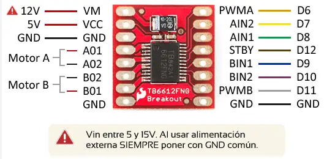
*Figura 5.4.1: Módulo estándar de puente H comercial.*

  

#### 5.4.2. Selección del Controlador de Alta Corriente: BTN9960LV (NovalithIC™)
Para superar estas limitaciones, se adopta la solución basada en el CI BTN9960LV (Infineon), popularizada en la categoría de alta competencia por equipos de alto rendimiento (como Space Invaders Robotics) y utilizada por los vehículos velocistas más rápidos. 

*   **Topología de Medio Puente (Half-Bridge):** El BTN9960LV no es un Puente H completo en un solo encapsulado, sino un medio puente integrado que incluye un MOSFET de lado alto (High-Side) y un MOSFET de lado bajo (Low-Side) con su respectivo circuito de disparo (driver IC). Para controlar un motor en ambos sentidos de giro, es necesario interconectar dos módulos BTN9960LV en paralelo para conformar un Puente H completo por cada motor. 
*   **Capacidad de Corriente y Tolerancia a Transitorios:**
    *   **Protección de Sobrecorriente Integrada:** Cuenta con un umbral de apagado por sobrecorriente (Overcurrent Shutdown) con valores típicos de 47 A (con mínimos de 35 A y máximos de 60 A a Vs = 13.5V). 
    *   **Gestión de Picos:** Dado que los motores de competencia jamás alcanzarán de forma continua dicho amperaje, este margen térmico y eléctrico asegura que los picos transitorios de corriente generados al alternar abruptamente la velocidad o polaridad sean absorbidos sin riesgo de falla o reinicio del sistema. 

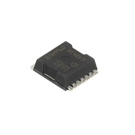
*Figura 5.4.2: Encapsulado de potencia del integrado BTN9960LV.*

  

#### 5.4.3. Implementación del Circuito Optimizado (Esquemático de Aplicación)
Aprovechando las recomendaciones del fabricante y la optimización de circuito realizada por la comunidad de robótica de competencia, se implementa una topología de medio puente desacoplada que se duplica por cada actuador: 

**Entradas de Control Lógico:**
*   **Pin de Habilitación (INH):** Controlado mediante lógica de 5V o 3.3V en serie con una resistencia de aislamiento de 1 kΩ (R1). 
*   **Pin de Modulación / Dirección (IN):** Recibe la señal PWM directamente desde el microcontrolador a través de una resistencia de 1 kΩ (R5). 

**Red de Desacoplo y Estabilización de Potencia:**
La línea de entrada de voltaje de potencia (VIN / Vs) se acopla mediante un arreglo de capacitores en paralelo para suprimir el ruido electromagnético de conmutación (EMC) y proveer reserva de corriente instantánea: 
*   Capacitores cerámicos de alta frecuencia: 100 nF (C4) y 470 nF (C2, C3). 
*   Capacitores de estandarización y filtrado: 10 µF (C5) y un electrolítico de reserva de 220 µF (C6) directo a la línea de tierra GND. 

**Salida al Motor (OUT / MOTCON):**
La terminal de salida OUT (pines 7 y 8) provee la conexión directa al borne del motor. Para construir el sistema de tracción diferencial del robot, se integran 4 integrados BTN9960LV en total sobre la PCB (2 medios puentes conformando el Puente H del Motor Izquierdo y 2 para el Motor Derecho). 

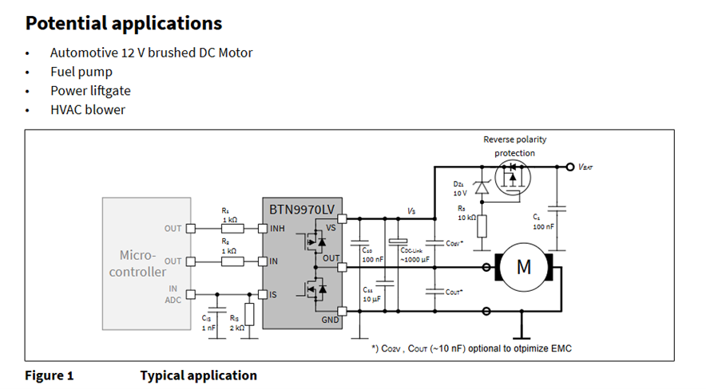{ width="800" }
*Figura 5.4.3: Esquemático de un solo medio puente.*

  

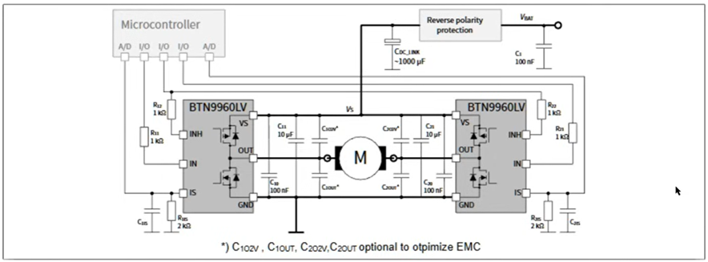{ width="800" }
*Figura 5.4.4: Conexión en paralelo de dos BTN9960 para conformar un puente H completo.*

  

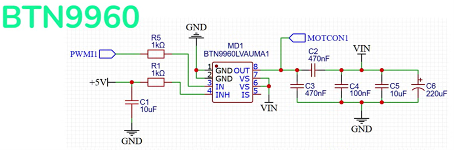{ width="800" }
*Figura 5.4.5: Circuito optimizado y acoplado con red de capacitores y resistencias de aislamiento.*

---

---

### 5.5. Interfaz de Control de Usuario: Sistema de Arranque mediante Pulsador en Configuración Pull-Down
Para cumplir con la normativa de seguridad y control en competencias de robots velocistas, se integra un mecanismo de arranque manual por pulsador táctil (Push Button). Este sistema permite al usuario dar la orden de inicio de rutina o calibración al microcontrolador de forma precisa.

#### 5.5.1. Análisis Comparativo de Topologías de Entrada Digital
La lectura de un botón exige fijar un estado lógico definido cuando el contacto mecánico está abierto, evitando que la línea de entrada del microcontrolador quede en un estado flotante (floating) susceptible a interferencias electromagnéticas:

*   **Configuración Pull-Up:** En estado de reposo, la línea de señal se conecta a VCC (+5V o +3.3V) mediante una resistencia de 10 kΩ, enviando un nivel lógico alto (HIGH / 1). Al oprimir el botón, el nodo se deriva a tierra (GND), forzando un nivel lógico bajo (LOW / 0).
*   **Configuración Pull-Down (Opción Seleccionada):** En estado de reposo, la entrada se referencia permanentemente a masa (GND) a través de la resistencia R2 (10 kΩ), manteniendo la señal en un nivel lógico bajo (LOW / 0). Al accionar el pulsador, el circuito cierra el camino desde VCC hacia el nodo de lectura, inyectando un nivel lógico alto (HIGH / 1).

**Justificación Técnica:** Se elige Pull-Down por su lógica positiva directa (una transición de 0 a 1 actúa como disparo) y por prevenir arrancadas falsas al mantener el pin forzado a 0V en estado pasivo.

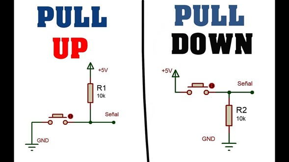
*Figura 5.5.1: Esquema de conexión para botones en topología Pull-Up y Pull-Down.*

  

---

### 5.6. Sistema de Alimentación y Regulación de Voltaje: Conversión Step-Down Eficiente
El diseño del subsistema de potencia debe garantizar un suministro eléctrico estable para la electrónica de control y percepción, aislando las caídas de voltaje inducidas por el consumo dinámico de los motores.

#### 5.6.1. Problemática de los Reguladores Lineales Tradicionales (L7805)
El regulador lineal de la serie LM7805 / L7805CV en encapsulado TO-220 es el estándar más común por su simplicidad y bajo costo, pero presenta severas limitaciones para un velocista:
*   **Ineficiencia Térmica:** Actúan como resistencias que disipan el exceso de voltaje en forma de calor. Al bajar la tensión de una batería LiPo (de hasta 12.6V) a 5V o 3.3V, se pierde más del 50% de la energía únicamente en calor.
*   **Efectos en la PCB:** Esta disipación térmica exige la incorporación de disipadores de aluminio pesados, contraviniendo directamente el criterio de ligereza y conservación de la batería.

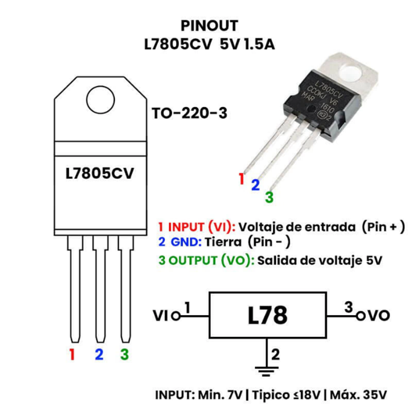
*Figura 5.6.1: Regulador lineal L7805CV en encapsulado TO-220.*

  

#### 5.6.2. Solución Mediante Reguladores Conmutados (Step-Down / Buck Converter)
Para optimizar el rendimiento energético, se sustituye la regulación lineal por una topología de conversión DC-DC conmutada:
*   **Principio de Operación:** Conmuta transistores de potencia a altas frecuencias, almacenando energía en un inductor y entregando un promedio eficiente de tensión en la salida.
*   **Eficiencia Energética:** Alcanza eficiencias superiores al 85% - 95%, minimizando el calentamiento y extendiendo la autonomía de la batería.

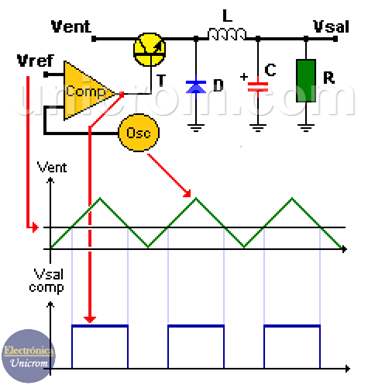
*Figura 5.6.2: Principio de funcionamiento de un convertidor DC-DC Buck (Step-Down).*

  

#### 5.6.3. Comparativa de Módulos Conmutados y Selección Final
*   **Módulo Regulador Pololu (Serie D24Vx):** Excelente precisión y tamaño ultracompacto, pero de costo elevado y baja disponibilidad local para reemplazos rápidos en campo.
*   **Módulo Convertidor HW-613 (Opción Seleccionada):** Altamente accesible, económico y con salida configurable (1.8V a 12V) mediante un puente de soldadura. Su empaquetado plano con pads castellados facilita soldarlo directamente como tarjeta hija (*breakout module*) sobre la placa base, ahorrando espacio vertical.

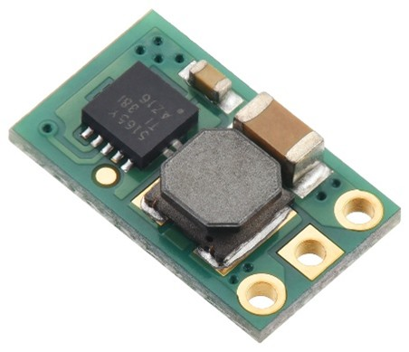
*Figura 5.6.3: Módulo Step-Down de precisión (Pololu).*

  

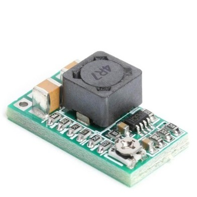
*Figura 5.6.4: Módulo convertidor Buck HW-613 seleccionado para el diseño.*

  

---

### 5.7. Fuente de Alimentación Principal: Análisis de Químicas de Baterías
La elección de la fuente de energía química determina la autonomía, la capacidad de respuesta dinámica (tasa de descarga C-Rating) y la distribución de peso sobre el chasis.

#### 5.7.1. Comparativa Tecnológica de Fuentes de Energía
*   **Baterías Estándar Recargables (NiMH / NiCd):** Comunes y accesibles, pero con baja densidad energética y peso elevado. Su baja tasa de descarga no satisface la demanda instantánea de los motores, provocando caídas de voltaje que reinician el sistema.

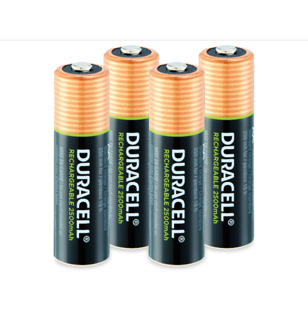
*Figura 5.7.1: Celdas recargables NiMH estándar (formato AA).*

  

*   **Baterías de Iones de Litio (Li-Ion - 18650):** Ofrecen mejor capacidad, pero su encapsulado cilíndrico metálico añade peso muerto no estructural. Carecen del pico de descarga requerido para un velocista de alta competencia.

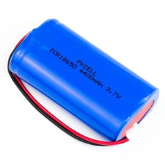
*Figura 5.7.2: Celda cilíndrica de Iones de Litio (18650).*

  

*   **Baterías de Polímero de Litio (LiPo - Opción Seleccionada):** Representan la solución óptima. Presentan empaquetados delgados y ligeros (pouch cell) que conservan el centro de masa bajo. Su altísima tasa de descarga (C-Rating) garantiza la entrega de energía durante maniobras de frenado activo y reaceleración sin caídas de tensión.

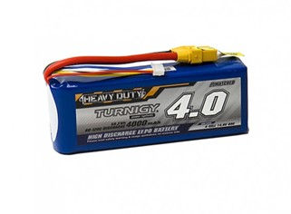
*Figura 5.7.3: Batería LiPo de alta tasa de descarga empleada en competencia.*

  

#### 5.7.2. Requerimientos de Mantenimiento y Seguridad
*   **Balanceo de Celdas:** Requieren cargadores balanceadores inteligentes (como el iMAX B6) conectados a la toma principal y al conector JST para igualar el potencial de cada celda de forma individual.
*   **Protocolos de Seguridad:** Las celdas sufren daños irreversibles si bajan de 3.0V - 3.2V. Una sobrecarga o exceso térmico genera gases (hinchamiento) que pueden derivar en ignición. Se recomienda la inclusión de monitores de voltaje o zumbadores de subtensión en la PCB.

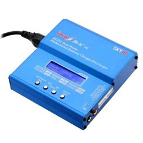
*Figura 5.7.4: Cargador/balanceador inteligente iMAX B6AC.*

  

---

### 5.8. Sistema de Adherencia Aerodinámica: Turbina de Succión y ESC
En los velocistas profesionales, el límite de paso por curva está restringido por la fuerza de fricción ($F_f = \mu \cdot N$). Aumentar la masa física penaliza la aceleración ($F = m \cdot a$), por lo que se implementa una turbina de succión para generar carga aerodinámica descendente (downforce).

#### 5.8.1. Principio Aerodinámico de Succión (Downforce)
Un motor sin escobillas (Brushless) acoplado a un impulsor extrae aire a altísimas RPM desde el espacio estanco entre la PCB y la pista. Al evacuar el aire por la parte superior, se genera una zona de baja presión debajo del vehículo. La presión atmosférica superior empuja el robot contra el suelo, incrementando artificialmente el agarre en curvas cerradas y la tracción en rectas.

#### 5.8.2. Selección del Controlador Electrónico de Velocidad (ESC)
Para operar el motor brushless de la turbina se requiere un variador electrónico (ESC) ultraligero con firmware BLHeli_S:
*   **Módulos Recomendados:** EMAX Bullet 20A (compacto y ultra liviano) o Favourite LittleBee 30A-S OPTO (de alto rendimiento, popular en drones FPV por su respuesta dinámica).
*   **Interfaz de Control:** El ESC se conecta a un pin de salida digital del ESP32-C6 y recibe una señal PWM (protocolos de servo de 1ms-2ms o DShot) para graduar la velocidad de la turbina según el tramo de la pista. Se alimentan directamente del bus principal de la batería LiPo para no interferir con la lógica de 5V/3.3V.

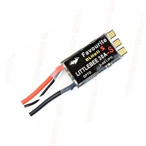
*Figura 5.8.1: Controlador de velocidad Favourite LittleBee 30A-S OPTO.*

  

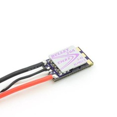
*Figura 5.8.2: Controlador ESC ultracompacto EMAX Bullet 20A.*
